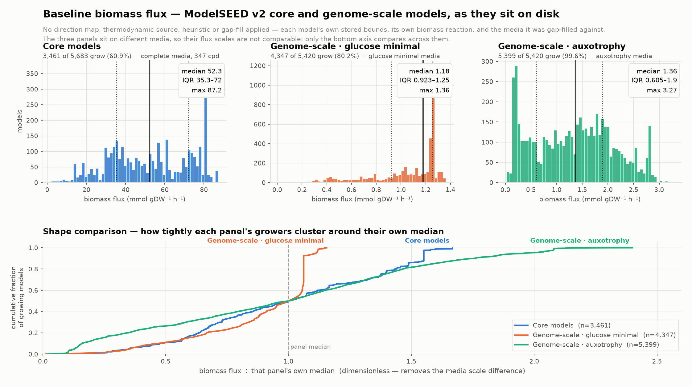
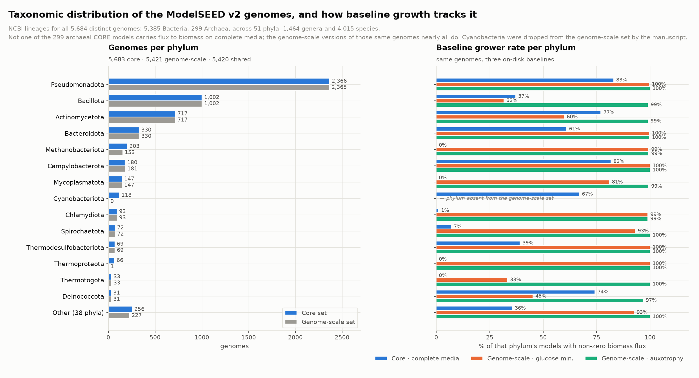
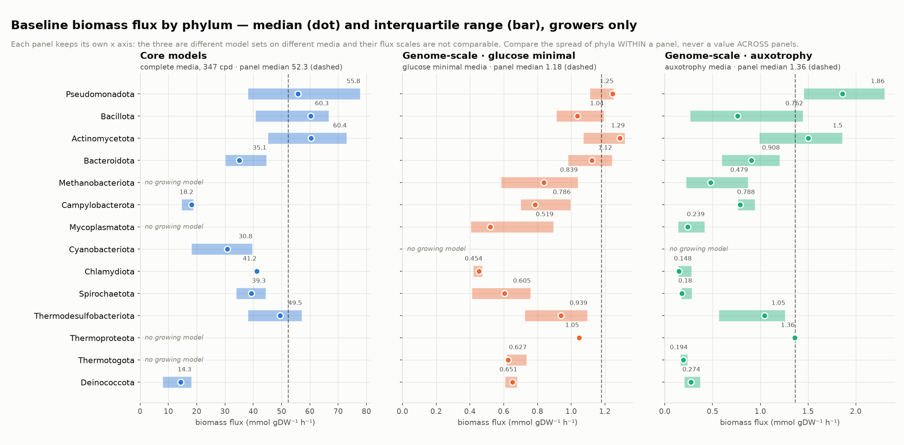

# Baseline biomass distribution and genome taxonomy — ModelSEED v2 core and genome-scale models

**Scope.** Two questions, answered over the two model sets the ModelSEED v2
manuscript produced:

1. Across every reaction as it sits on disk, what is the distribution of
   biomass flux where growth is possible?
2. What is the taxonomic distribution of the genomes those models were
   reconstructed from?

**Baseline definition.** "Baseline" is the models exactly as distributed: each
model's own stored lower/upper bounds, its own biomass reaction, and the media
it was gap-filled against. No direction map, no thermodynamic source, no
heuristic cascade, no additional gap-filling. This is the `on_disk` condition
the influence pipeline reserves, and it is the reference every thermodynamic
variant in this repo is measured against.

Generated by:

| step | script | output |
|---|---|---|
| taxonomy gap fill | `scripts/resolve_missing_taxonomy.py` | `results/ncbi_taxonomy_fill.csv` |
| tables | `scripts/build_baseline_biomass_taxonomy.py` | `results/baseline_biomass_taxonomy/` |
| figures | `scripts/plot_baseline_biomass_taxonomy.py` (registry `baseline_biomass_taxonomy`) | `reports/baselineBiomassTaxonomy/figures/baseline_biomass_taxonomy/` |
| ATP cross-check | `scripts/analyze_core_atp_production.py` | `results/core_atp_production.tsv` |
| supplement reconciliation | `scripts/verify_ms2_supplement_counts.py` | stdout only |

Redraw with `python3 scripts/regen_figures.py baseline_biomass_taxonomy`.

---

## 1. Biomass distribution

Three panels, because the two model sets were deposited against different
media and there is no single condition that covers both.

| panel | models | media | growers | % | min | Q1 | median | mean | Q3 | max | SD | CV |
|---|---|---|---|---|---|---|---|---|---|---|---|---|
| Core | 5,683 | ModelSEED complete (`KBaseMedia.cpd`, 347 cpd) | 3,461 | 60.9% | 2.03 | 35.32 | **52.30** | 52.39 | 71.95 | 87.21 | 20.68 | 0.395 |
| Genome-scale | 5,420 | glucose minimal (`Carbon-D-Glucose`, −10) | 4,347 | 80.2% | 0.0124 | 0.923 | **1.178** | 1.041 | 1.251 | 1.361 | 0.287 | 0.276 |
| Genome-scale | 5,420 | auxotrophy (−10) | 5,399 | 99.6% | 0.0206 | 0.605 | **1.365** | 1.319 | 1.896 | 3.275 | 0.779 | 0.591 |

Flux units are mmol gDW⁻¹ h⁻¹. Every model solved to `optimal`; there are no
infeasible or unbounded solves in any panel, so "does not grow" always means a
feasible solution with zero flux to biomass, never a solver failure.

> **The three flux columns are not comparable to each other.** The core panel
> runs on a 347-compound complete medium with the models' own largely
> unconstrained exchange bounds, which is why its fluxes sit ~40× above the
> genome-scale panels. Compare the *shape* of each distribution and the grower
> fraction across panels; compare flux values only within a panel.

**What the shapes say.** Normalising each panel by its own median (bottom axis
of the figure) removes the media scale and leaves the dispersion:

- **Genome-scale on glucose minimal is the tightest distribution** (CV 0.276)
  and is sharply right-censored — 90% of growers fall below 1.07× the median
  and the maximum is only 1.16× the median. The gap-filling target was growth
  on exactly this medium, so the models cluster just above the threshold that
  gap-filling had to clear.
- **Auxotrophy media is the widest** (CV 0.591) and the only panel with a long
  upper tail (max 2.4× median). Supplying amino acids and vitamins removes the
  biosynthetic bottleneck, so organism-to-organism differences in catabolic
  capacity show up instead of being masked.
- **Core models are intermediate** (CV 0.395) and visibly multi-modal — the
  histogram has distinct clusters, which tracks the small number of distinct
  core-template configurations rather than a continuum.

Model sizes for context: core models hold 41–221 reactions (median 156);
genome-scale models hold 330–1,911 (median 1,187).

---

## 2. Taxonomic distribution

Lineages are NCBI, joined per genome. Coverage is complete: the original
`ncbi_taxonomy.csv` left 122 genomes blank because their RefSeq assemblies have
since been suppressed, and one genome in the genome-scale set
(`GCF_000009085.1`, *Campylobacter jejuni* NCTC 11168) had no row at all.
`resolve_missing_taxonomy.py` recovered all 125 through Entrez, which retains
suppressed assemblies. Only 2 of 5,684 genomes now lack a phylum, and that is
because NCBI itself assigns them none (*Candidatus* Babela massiliensis,
*Bradymonas sediminis*).

### Genome sets

| | genomes | Bacteria | Archaea |
|---|---|---|---|
| Core set | 5,683 | 5,384 | 299 |
| Genome-scale set | 5,421 | 5,266 | 155 |
| Shared | 5,420 | | |
| Core only | 263 | 119 | 144 |
| Genome-scale only | 1 | 1 | 0 |
| **Union** | **5,684** | **5,385** | **299** |

Across the union: **51 phyla, 108 classes, 235 orders, 517 families,
1,464 genera, 4,015 species.** No eukaryotes — the manuscript reconstructs
Bacteria and Archaea only.

### Top phyla

| phylum | union | core | genome-scale | core growers | GSM-GMM growers | GSM-auxo growers |
|---|---|---|---|---|---|---|
| Pseudomonadota | 2,366 | 2,366 | 2,365 | 83.0% | 99.6% | 100% |
| Bacillota | 1,002 | 1,002 | 1,002 | 37.1% | 31.6% | 99.1% |
| Actinomycetota | 717 | 717 | 717 | 77.0% | 59.8% | 99.0% |
| Bacteroidota | 330 | 330 | 330 | 60.9% | 99.7% | 99.7% |
| Methanobacteriota | 203 | 203 | 153 | 0% | 99.3% | 99.3% |
| Campylobacterota | 181 | 180 | 181 | 81.7% | 100% | 100% |
| Mycoplasmatota | 147 | 147 | 147 | 0% | 81.0% | 99.3% |
| Cyanobacteriota | 118 | 118 | **0** | 66.9% | — | — |
| Chlamydiota | 93 | 93 | 93 | 1.1% | 98.9% | 98.9% |
| Spirochaetota | 72 | 72 | 72 | 6.9% | 93.1% | 100% |

The distribution is heavily skewed: the top three phyla hold 4,085 of 5,684
genomes (72%). Archaea are 299 genomes (5.3%) of the core set but only 155
(2.9%) of the genome-scale set.

### Why the two sets differ by 263 genomes

This reconciles exactly against the manuscript's own supplement. Recheck with
`scripts/verify_ms2_supplement_counts.py` (it takes the two workbooks from
<https://bioseed.mcs.anl.gov/~fliu/modelseed2/> as arguments; the docstring has
the download lines):

| | genomes | |
|---|---|---|
| Supp. Table 4 `taxonomy` (the manuscript's core manifest) | 5,539 | paper states 5,540 |
| Supp. Table 5 `Figure 6 data` (genome-scale manifest) | 5,419 | paper states 5,420 |
| **T4 − T5** | **120** | 118 Cyanobacteriota + 1 Elusimicrobiota + 1 Mycoplasmatota |
| **On disk but not in T4** | **145** | 144 Archaea + 1 Bacteria |

- **118 cyanobacteria were deliberately excluded** from the genome-scale study.
  The paper: *"For the genome-scale study we excluded cyanobacteria, reducing
  our set in that analysis to 5,420 organisms"* — because no cyanobacteria
  specific template exists. The paper never states the subtraction numerically;
  120 is computed here.
- **145 genomes on disk are beyond the manuscript's set.** The distributed
  `core_models.tar.gz` ships 5,683 core models where the paper analyses 5,540.
  The 145 extras are 144 Archaea (Thermoproteota 65, Methanobacteriota 50,
  Nitrososphaerota 15, Thermoplasmatota 13, Microcaldota 1) plus 1
  Pseudomonadota. This looks like a later, expanded release of the supplement,
  not an error — but **5,683 is not a number the paper uses anywhere**, so cite
  5,540 when referring to the manuscript's analysis and 5,683 when referring to
  what the supplement actually ships.

145 + 118 = 263, the core-only count above — the arithmetic closes exactly.

Two genomes Supp. Table 5 lists as dropped are nonetheless **present** in the
deposited genome-scale set: `GCF_000376625.1` (*Mycoplasma putrefaciens*
Mput9231) and `GCF_002355835.1` (*Candidatus* Endomicrobiellum trichonymphae).
That is why the deposited set spans 5,421 genomes where the sheet lists 5,419,
and it is also why the GMM and auxotrophy deposits are not over an identical
genome list (see Caveats).

**Genome provenance (from the paper).** Genomes are KEGG's Bacteria and Archaea
list, using the RefSeq assembly versions hosted in KBase — not PATRIC/BV-BRC,
not GTDB. Membership in that KEGG set is the only stated inclusion criterion;
no assembly-quality, completeness or dereplication filter is described, and no
KEGG release version or download date is given. Three reconstruction templates
are used: Archaea, Bacteria gram-positive, Bacteria gram-negative.

**The paper publishes no taxonomic census.** There is no domain-, phylum- or
class-level breakdown in the article text; the only taxon counts there are
incidental to specific findings. Every per-phylum number in this report is
computed here, from NCBI lineages joined onto the genome accessions.

---

## 3. Growth by phylum, and the archaeal zero

The single largest structure in the baseline is this:

> **Not one of the 299 archaeal core models carries flux to biomass** on
> complete media — 0.0 in all 299, not a small number. The same genomes'
> genome-scale models grow at 99.4%.

That is real, but it would be misread as "the archaeal core models are broken."
They are not, and the reason is a definitional one worth stating clearly.

**Every core model has two reactions named `biomass`, and they are different
things:**

| id | reaction | role |
|---|---|---|
| `bio1` | 12 central-carbon precursors + 41.26 ATP + NAD(P)H → `cpd11416_c0` | the actual core biomass; what `results.csv` optimises |
| `bio2` | ATP + H₂O → ADP + Pᵢ + H⁺ | pure ATP hydrolysis — a demand reaction, not a biomass |

`bio2` is the test reaction for the manuscript's core-model criterion:
*"Production of ATP from ADP and phosphate in at least one media is verified
for the reconstructed core model."* Its flux saturates at the 1000 upper bound
whenever it is feasible, so only feasible/infeasible is meaningful.

Re-solving all 5,683 core models under both objectives on the same complete
medium (`results/core_atp_production.tsv`):

| domain | n | biomass `bio1` | ATP `bio2` |
|---|---|---|---|
| Bacteria | 5,384 | 3,461 (64.3%) | 4,944 (91.8%) |
| Archaea | 299 | **0 (0.0%)** | **97 (32.4%)** |
| **All** | **5,683** | **3,461 (60.9%)** | **5,041 (88.7%)** |

Contingency: 3,461 make both, 1,580 make ATP but not biomass, 642 make neither,
and **0 make biomass without ATP** (structurally guaranteed, since `bio1`
consumes ATP). So the ATP criterion is strictly weaker than the biomass
criterion, and the baseline grower fraction is a *biomass* statistic, not the
manuscript's validation statistic.

Two caveats follow, and both matter for how the archaeal zero is reported:

1. **The manuscript tests core models across 54 minimal media formulations**
   (Supplementary Table 1 — `Glc.O2`, `H2.CO2`, `H2.Ac`, `For.SO4.H2`, `ANME`,
   `Methane`, `Methanol.H2`, `Trimethylamine.H2`, `Light`, …), and passes a
   model if ATP is produced in **at least one** of them. The baseline here uses
   **one** complete medium. 32.4% of archaea pass the ATP test on that single
   medium; the manuscript's 54-media protocol would pass substantially more.
2. The complete medium does contain H₂ and CO₂, but **not** methanol, methane
   or formate — so methylotrophic and acetoclastic methanogens have no
   substrate on it regardless of how their model is built.

The honest statement is therefore: *on a single complete medium, with biomass
as the objective, no archaeal core model carries flux* — not *archaeal core
models cannot produce ATP*, and not *the archaeal template is broken*.

A similar reading applies to the other 0%/low-% core rows (Mycoplasmatota 0%,
Chlamydiota 1.1%, Spirochaetota 6.9%, Thermotogota 0%): these are obligate
host-associated or strictly anaerobic organisms whose core models are not
expected to reach biomass on one aerobic-capable complete medium, and whose
genome-scale counterparts grow at 81–100% once gap-filled against a defined
medium.

---

## 4. Data files

In `results/baseline_biomass_taxonomy/`:

| file | contents |
|---|---|
| `per_model.tsv` | one row per (panel, model): growth, grows, sizes, full lineage |
| `biomass_summary.tsv` | per-panel grower counts and flux quantiles |
| `biomass_deciles.tsv` | per-panel decile edges of the grower flux |
| `taxonomy_<rank>.tsv` | genome counts and grower rates per taxon, 7 ranks |
| `biomass_by_phylum.tsv` | per panel × phylum: n, growers, median/mean/IQR |
| `summary.json` | all of the above, machine-readable |

Elsewhere: `results/ncbi_taxonomy_fill.csv` (the 125 recovered lineages),
`results/core_atp_production.tsv` (bio1 vs bio2 per core model), and
`figure_stats.tsv` beside the PNGs with the numbers the figures assert.

## 5. Caveats

- The core panel's complete medium is **this repo's** baseline convention, not
  the manuscript's core protocol (54 minimal media). It is the right baseline
  for comparing thermodynamic variants against each other, which is what it
  was built for; it is not the right baseline for judging core-model quality.
- The two genome-scale media sets are **not over an identical genome list**:
  each contains one genome the other lacks (`GCF_000010505.1` in GMM only,
  `GCF_000376625.1` in auxotrophy only). Both deposits hold 5,420 models; their
  union is 5,421 genomes.
- Genome-scale growth values are read from the cached `on_disk` entry of
  `results/influence_v201/{gsm_gmm,gsm_auxo}/growth.json`, produced 2026-09-21.
  They were not re-solved for this report.
- Taxonomy is current NCBI, which has renamed most bacterial phyla since the
  manuscript was written (Firmicutes → Bacillota, Proteobacteria →
  Pseudomonadota, …). Supplementary Table 5 uses the pre-2021 names.
