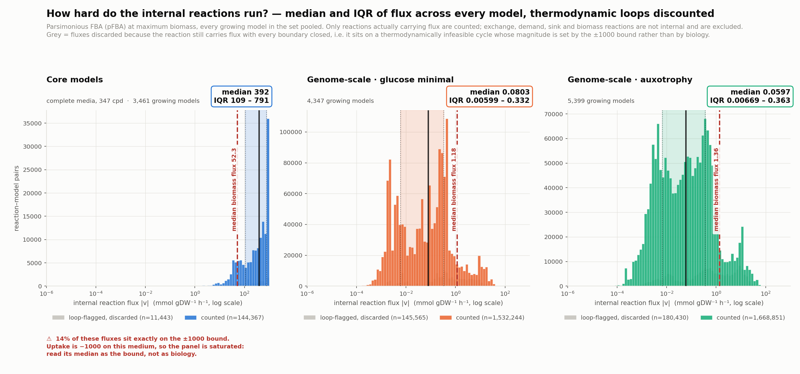
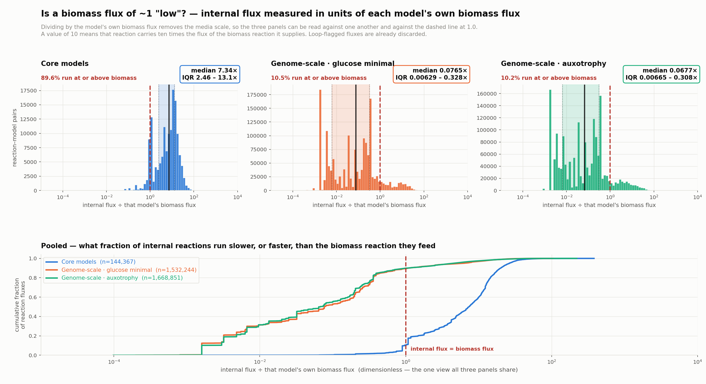
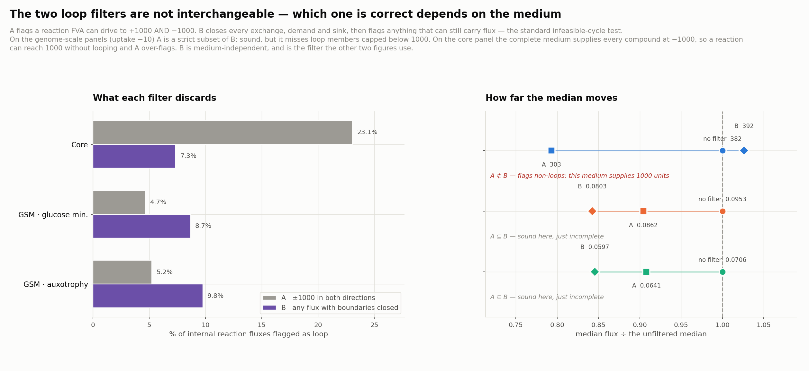

# Internal-flux distributions, with thermodynamic loops discounted

**Built 2026-10-20.** Sweep: `scripts/build_flux_distributions.py`
(16,523 models, ~26 min on 200 workers, 0 errors).
Figures: `scripts/plot_flux_distributions.py`, registry name `flux_distributions`.
Numbers below are recheckable against
`reports/fluxDistributions/figures/flux_distributions/figure_stats.tsv` and
`results/flux_distributions/<set>/summary.json`.

## The question

A genome-scale model's biomass flux is ~1.2 mmol gDW⁻¹ h⁻¹, which sounds small.
But biomass is a single reaction with ~60 precursors, so the reactions feeding
it might be running far harder. How hard do the internal reactions actually
run — and what is their median and IQR once thermodynamically infeasible cycles
are excluded?

## Headline answer

**It depends entirely on which model set you ask, and the intuition holds for
one and inverts for the other.**

| panel | growing models | internal fluxes counted | median \|v\| | IQR | median ÷ biomass | % at or above biomass |
|---|---|---|---|---|---|---|
| Core · complete media | 3,461 | 144,367 | **392** | 109 – 791 | **7.34×** | **89.6%** |
| Genome-scale · glucose minimal | 4,347 | 1,532,244 | **0.0803** | 0.0060 – 0.332 | **0.0765×** | 10.5% |
| Genome-scale · auxotrophy | 5,399 | 1,668,851 | **0.0597** | 0.0067 – 0.363 | **0.0677×** | 10.2% |

Flux in mmol gDW⁻¹ h⁻¹. Loop filter **B** applied (see below). Median biomass
flux: 52.3 / 1.178 / 1.365.

- **On core models the intuition is right**: the median internal reaction runs
  at 7.3× the biomass flux and 89.6% of them run at or above it.
- **On genome-scale models it inverts**: the *median* internal reaction runs at
  about **1/13th** of the biomass flux, and only ~10% run at or above it. A
  genome-scale model is mostly a long tail of trace biosynthetic steps, each
  making a minor biomass component at 10⁻²–10⁻³.
- **But the top of the distribution does behave as expected.** The 95th
  percentile is 5.69 (GMM) and 6.64 (auxo) — roughly **5× the biomass flux** —
  and the maximum is 65 and 119. Central carbon metabolism really does run an
  order of magnitude above biomass; it is simply outnumbered.

So "a biomass flux of 1 is low because biomass has many components" is true of
the *busy* part of the network and false of the *typical* reaction. The right
statement is that internal flux spans ~6 orders of magnitude, and which end you
quote decides the answer.

**Robustness.** Pooling weights big models more heavily. Taking the median of
each model's own median instead gives 428 (core) and 0.0933 (GMM) against
pooled 392 and 0.0803 — same conclusion either way.

## The loop filters: the ±1000 test is right on one panel and wrong on another

Two filters were computed for every reaction of every model:

- **A — the ±1000 test.** FVA with the medium applied; flag a reaction that can
  reach `≥ +1000` *and* `≤ −1000`.
- **B — the closed-exchange test.** Shut every boundary reaction, then FVA;
  flag anything that can still carry flux. Nothing can enter or leave, so any
  remaining flux is an internal cycle. This is the standard type-III /
  infeasible-loop definition.

| panel | A flags | B flags | A-only | B-only | A ⊆ B? |
|---|---|---|---|---|---|
| Core | 35,946 (23.1%) | 11,443 (7.3%) | 28,797 | 4,294 | **no** |
| GSM · glucose minimal | 78,046 (4.7%) | 145,565 (8.7%) | **0** | 67,519 | **yes** |
| GSM · auxotrophy | 96,720 (5.2%) | 180,430 (9.8%) | **0** | 83,710 | **yes** |

**On the genome-scale panels A is exactly sound.** Across 3.5 million flux
values its false-positive count is **zero** — every reaction it flags is also
flagged by the rigorous test. That is a real validation of the criterion: when
uptake is capped at −10, nothing can carry a thousand units in both directions
except a cycle. A is merely *incomplete*, catching 54% (GMM) and 54% (auxo) of
the loop reactions, because a loop member can be bounded below 1000 in one
direction and so escape the test.

**On the core panel A is not valid.** That medium supplies every compound at
**−1000**, so a reaction can legitimately reach 1000 without any loop. A flags
23.1% against the true 7.3%, and is no longer even a superset or subset — it
flags 28,797 values B does not, while missing 4,294 that B catches. On that
panel A measures the uptake bound.

**B is therefore the default**, because it is the only one of the two whose
meaning does not change with the medium. Both are stored per flux value in
`fluxes.npz`, so either can be re-applied without re-solving (`--filter a`).

Reassuringly, the choice barely moves the headline: median 392 (B) vs 382
(unfiltered) vs 303 (A) on core; 0.0803 vs 0.0953 vs 0.0862 on GMM.

## Caveat: the core panel is saturated against its own bound

**13.9% of the core panel's counted fluxes sit exactly on ±1000, and 75.8% are
≥ 100.** The genome-scale panels have *zero* values at the bound, and between
them exactly one flux above 100 (118.6, out of 3.2 million).
With uptake at −1000 the core models are flooded, and their flux
magnitudes are set by the arbitrary bound rather than by metabolism — which is
why their 95th percentile is exactly 1000.

Treat the core panel's "7.3× biomass" as a statement about how that medium is
configured, not as a biological result. The genome-scale panels, constrained at
−10, are the trustworthy read on internal flux activity. This is flagged on the
figure itself.

## Method

- **Flux vector: pFBA, not plain FBA.** Plain FBA picks an arbitrary vertex
  among alternate optima, so a median over its values is not reproducible. pFBA
  minimises total absolute flux at optimal biomass and is also the conservative
  choice here: if even the minimal-flux solution shows reactions well above
  biomass flux, the point holds a fortiori.
- **Internal** = not a boundary reaction (cobra's own exchange/demand/sink
  classification) and not a `bio*` reaction.
- **Only reactions carrying flux are counted** (`|v| > 1e-9`). Including the
  zeros would make every median 0 — most of a genome-scale model is inactive on
  any one medium — which measures model size, not activity.
- Non-growing models contribute nothing; growth threshold 1e-6, matching the
  repo convention.
- FVA at `fraction_of_optimum=0.0`, so loop membership is a structural property
  of the network rather than something conditional on optimal growth.

### How the loops are actually detected

Both filters are built on cobrapy's `flux_variability_analysis`. **Filter B is
not a different algorithm** — it is the same call, run on a model whose
boundary reactions have been closed. That is the only difference between them.
From `scripts/build_flux_distributions.py` (`analyse_one`):

```python
from cobra.flux_analysis import flux_variability_analysis, pfba

# Internal = not a boundary reaction (cobra classifies exchange/demand/sink
# itself) and not a biomass reaction.
boundary = {r.id for r in model.boundary}
internal = [r.id for r in model.reactions
            if r.id not in boundary and not r.id.startswith("bio")]

# --- the flux vector: parsimonious, so it is reproducible ---
fluxes = pfba(model).fluxes

# --- filter A: can it run LOOP_BOUND in BOTH directions? ---
fva = flux_variability_analysis(model, fraction_of_optimum=0.0,
                                processes=1)
loop_a = set(fva.index[(fva["maximum"] >= LOOP_BOUND - LOOP_EPS)
                       & (fva["minimum"] <= -LOOP_BOUND + LOOP_EPS)])

# --- filter B: with nothing entering or leaving, what still moves? ---
# The context manager reverts the bounds, which is far cheaper than
# re-reading the model from disk.
with model:
    for rid in boundary:
        model.reactions.get_by_id(rid).bounds = (0.0, 0.0)
    fva_c = flux_variability_analysis(model, fraction_of_optimum=0.0,
                                      processes=1)
loop_b = set(fva_c.index[(fva_c["maximum"].abs() > CLOSED_TOL)
                         | (fva_c["minimum"].abs() > CLOSED_TOL)])
```

with `LOOP_BOUND = 1000.0`, `LOOP_EPS = 1e-2`, `CLOSED_TOL = 1e-6`.

Three arguments carry more weight than they look:

- **`fraction_of_optimum=0.0`.** FVA defaults to `1.0`, which asks "what can
  this reaction do *while the model still grows optimally*" and makes loop
  membership conditional on growth. `0.0` asks the structural question
  instead. It is also *required* for filter B, where the model cannot grow at
  all once the exchanges are shut.
- **`processes=1`.** cobra's FVA otherwise forks its own worker pool, which
  deadlocks inside the 200-way `ProcessPoolExecutor` the sweep runs in.
- **`with model:`.** cobra's context manager reverts the bound changes on
  exit, so filter B does not need the model re-read from disk. This roughly
  halved the sweep: a genome-scale model costs ~2.2 s just to load.

`pfba` supplies the flux *values* that get medianed; the two FVA calls only
decide which of those values to keep.

## Figures

All three live in `reports/fluxDistributions/figures/flux_distributions/` and
are regenerated with `python3 scripts/regen_figures.py flux_distributions`.

### 1. The distributions — the headline



One panel per model set. The coloured histogram is the flux that **counts**;
the grey histogram behind it is what filter B **discarded** as loop. The solid
black rule is the median, the dotted rules the quartiles, and the shaded band
the IQR. The red dashed rule is that panel's **median biomass flux**, so the
comparison the figure exists to make is the horizontal gap between the black
rule and the red one.

The x axis is log because internal flux spans ~6 orders of magnitude; its range
is taken from the data, so nothing is cropped — an empty stretch is genuinely
empty. Quantiles are always computed on raw values, never on logs.

Read it as: **core sits to the right of its biomass line, both genome-scale
panels sit to the left of theirs.** The red warning under the core panel is the
saturation caveat above — 14% of those fluxes are pinned on the ±1000 bound.

### 2. Flux in units of biomass flux — the direct answer



The same data divided by each model's *own* biomass flux. That removes the
media scale, so all three panels legitimately share one axis and the dashed
line at 1.0 means "this reaction runs exactly as fast as the biomass reaction
it feeds".

The pooled ECDF along the bottom is the clearest single view in the report: the
blue core curve and the two genome-scale curves are separated by about two
decades, and where they cross 1.0 gives the "% at or above biomass" column of
the headline table — 89.6% for core against ~10% for both genome-scale panels.

### 3. Loop accounting — why filter B is the default



**Left — how much each filter throws away**, as a share of that panel's
internal reaction fluxes. The relationship between the two bars *flips*: on
core, A discards 3× more than B (23.1% vs 7.3%); on both genome-scale panels it
discards about half as much (4.7% vs 8.7%). That flip is the figure's point.

**Right — whether discarding changes the answer.** Each row is a panel; the
three marks are the median under no filter (circle), A (square) and B
(diamond), plotted as a ratio to the unfiltered median, so the circle is always
at 1.0 and the displacement is readable directly. The absolute median is
printed beside each mark. The italic line is the per-panel verdict: grey
`A ⊆ B` on the genome-scale rows, red `A ⊄ B` on core.

**The one counterintuitive mark** is core's B diamond, which sits to the
*right* of 1.0 — filtering *raised* that median, 382 → 392, where every other
mark moves left. The reason is what each filter is grabbing:

| panel | median of A-flagged | median of B-flagged | panel median |
|---|---|---|---|
| Core | **697** (20.1% pinned at 1000) | **255** | 382 |
| GSM · glucose minimal | 0.347 | 0.382 | 0.095 |
| GSM · auxotrophy | 0.464 | 0.500 | 0.071 |

In the genome-scale models loops behave as theory predicts — they are **fast**,
4–7× the panel median — so removing them pulls the median down. On core that
breaks: A is grabbing the *highest* fluxes (median 697, a fifth of them pinned
at the bound) because on a flooded medium "runs at 1000" means saturated, not
looping, while the genuine cycles B finds are comparatively **modest** (median
255, below the panel median) and removing them nudges the median up.

## Related

- [BASELINE_BIOMASS_TAXONOMY.md](BASELINE_BIOMASS_TAXONOMY.md) — the
  biomass-flux side of the same three panels, and why the two genome-scale
  panels share an axis.
- `scripts/build_flux_distributions.py` docstring — every threshold, with the
  measurement that motivated it.
