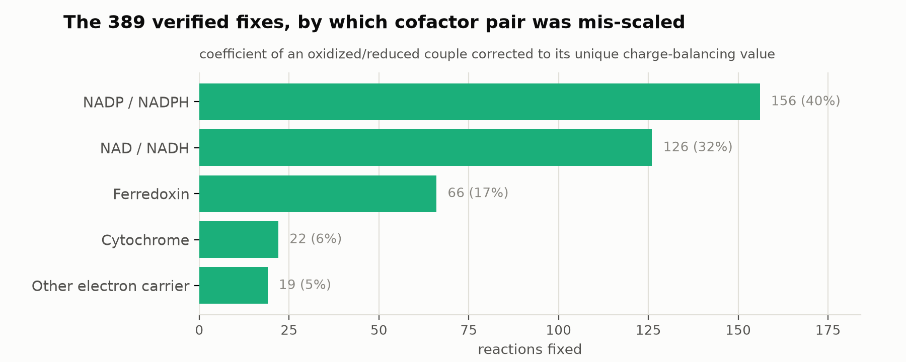

# Fixing ModelSEED's charge-imbalance-only (`CI`) reactions

Built 2026-10-12 against ModelSEED `dev` @ `078a395f`
(`/scratch/ctaylor/tmp/devsnap_078a395f`) — reconfirmed still == `origin/dev`
HEAD on this date (unchanged since the 2026-10-06 merge), so this is current.

**Scope**: this is a follow-up to
[`reports/reactionBalanceFlags/REACTION_BALANCE_FLAGS.md`](../reactionBalanceFlags/REACTION_BALANCE_FLAGS.md),
which found **2,824 reactions** carrying `status = CI:N` only (a charge
imbalance with no accompanying mass imbalance) and guessed, without
verifying it, that ~778 of them shared one templating bug. This report
re-examines all 2,824 directly, finds that guess doesn't hold up, identifies
what the real, verifiable pattern is, and **applies it**.

## Recap: what `CI`-only means

ModelSEED's `balanceReaction()` computes two independent checks per
reaction: net mass (per chemical element) and net formal charge. A reaction
flagged `CI:N` with no `MI` token has **already been confirmed
mass-balanced** — every element's atom count cancels exactly — but the net
charge is off by `N`. That matters: it rules out "a dropped atom" as the
cause and means whatever's wrong is a pure charge-accounting error.

## Why the previous guess didn't hold up

The earlier report noticed that 778 of the 2,824 are auto-generated
"combinatorial expansion" reactions (visible via an
`.{organism}exp.`-tagged `abbreviation`, e.g. pairing a generic
dehydrogenase template against many specific substrates) and guessed this
reflected one shared templating bug — "a proton coefficient that wasn't
recalculated correctly" — without reading the generator or checking a
single equation by hand.

Reading actual equations shows that's not it. For example:

```
rxn12950  (expansion reaction, status CI:2)
  (1) NADH[0] => (1) NAD[0]
```

That's not a proton slip — the reaction's real substrate/product pair was
dropped entirely during template expansion, leaving only the bare cofactor
swap. No amount of H⁺ adjustment fixes a reaction missing its actual
chemistry. This single example was enough to show the "778 reactions, one
proton-coefficient bug" story needed to be re-derived from the actual
numbers, not assumed.

## The real, verifiable mechanism

Since mass is already confirmed balanced, fixing the charge **without**
touching mass requires changing something whose own mass contribution
cancels regardless of its coefficient. The natural candidate: a redox
cofactor couple already present in the equation — e.g. NAD/NADH, NADP/NADPH,
oxidized/reduced ferredoxin, cytochrome c2+/c3+ — where both forms share an
**identical chemical formula** but a different formal charge (ModelSEED
folds the hydride/electron transfer entirely into the `charge` field, not
the formula). Rescaling such a pair's shared coefficient by one integer
multiplier changes the reaction's net charge but is mathematically
guaranteed to leave net mass untouched, since any multiple of the same
formula still cancels to zero.

So for every `CI`-only reaction, the fix-finding procedure is:

1. Confirm computationally that mass really is balanced (independent check
   of ModelSEED's own `status`, not just trusting the label).
2. For every reactant/product pair sharing an exact formula match, solve for
   the one integer rescaling of that pair's coefficients that exactly zeros
   the net charge, while holding the *difference* between the two
   coefficients fixed at its current value (the exact condition under which
   that pair's own net-mass contribution is unchanged, whether or not the
   two coefficients started out equal).
3. Keep only solutions with positive, chemically sane coefficients (1 to 12
   — rejecting zero/negative, which would mean deleting or reversing the
   cofactor's role, not rescaling it).
4. If exactly one such pair-and-multiplier exists, rebuild the full
   corrected equation and **independently recompute mass and charge from
   scratch** (not just the pair algebra) to verify it actually balances.

A worked example —

```
rxn31544  NADP[0] + 8-Hydroxygeraniol[0]  <=>  NADPH[0] + (4) H+[0] + 8-Oxogeranial[0]      status CI:2
```

8-Hydroxygeraniol (C₁₀H₁₈O₂) → 8-Oxogeranial (C₁₀H₁₄O₂) loses 4 hydrogens —
a double oxidation, not a single one — so the equation already (correctly)
carries 4 free H⁺. But it only uses **one** equivalent of NADP/NADPH, when a
double oxidation needs two hydride-acceptor equivalents. Mass was already
exactly balanced at every coefficient shown (independently confirmed); only
the cofactor pair's own coefficient was wrong. Rescaling NADP → (2) and
NADPH → (2) is the single integer fix that exactly zeros the charge:

```
(2) NADP[0] + 8-Hydroxygeraniol[0]  <=>  (2) NADPH[0] + (4) H+[0] + 8-Oxogeranial[0]
```

## Results


| outcome | n | share |
|---|---:|---:|
| uniquely fixed & verified | **389** | 13.8% |
| ambiguous (2+ independently valid pairs) | 2 | 0.07% |
| needs individual review | 2,433 | 86.2% |

*(Figure source: `scripts/plot_ci_only_fix_outcomes.py`, registered in
`scripts/figures.tsv` as `ci_only_fix_outcomes`. Data in
`results/ci_only_fixes/outcome_counts.tsv`.)*

### The 389 fixes, by cofactor family



| family | n | share |
|---|---:|---:|
| NADP / NADPH | 156 | 40% |
| NAD / NADH | 126 | 32% |
| Ferredoxin (generic + 2Fe-2S) | 66 | 17% |
| Cytochrome | 22 | 6% |
| Other (O₂/O₂⁻, putidaredoxin, rubredoxin, azurin, Cu(I)/Cu²⁺, ...) | 19 | 5% |

*(Figure source: `scripts/plot_ci_only_fix_families.py`, registered as
`ci_only_fix_families`. Data in `results/ci_only_fixes/pair_family_counts.tsv`.)*

The coefficient changes themselves are almost entirely small, simple
multiples — overwhelmingly a 1↔2 correction (258 of 389), with a long tail
out to 2↔4, 1↔6, 1↔7, and a few larger multi-electron reactions. The four
largest-coefficient cases were individually checked and make chemical
sense: two fatty-acid-synthase elongation reactions (`rxn10102`, `rxn10103`,
condensing Acetoacetyl-ACP + Malonyl-ACP into a longer acyl-ACP) are
currently written with 11 and 13 NADPH respectively, when 10 and 12 balance
— and a 3-O₂-to-6-H₂O reaction that forgot to scale its 4-cytochrome-per-O₂
stoichiometry by 3 (should be 12, not 4) is another.

### What else turned up along the way

Two reactions (`rxn14159`, `rxn31414`) have **two independently valid**
cofactor pairs in the same equation (an NADP/NADPH pair *and* a ferredoxin
pair), each of which alone could explain the charge gap. Which one is
actually miscounted depends on the real enzyme mechanism, not arithmetic —
these are listed in `results/ci_only_fixes/ambiguous.tsv` but **not**
auto-fixed.

Of the 2,433 that remain unresolved, most (1,710, 70%) have no
same-formula redox-pair lever in the equation at all — this mechanism
simply doesn't apply, the same way `rxn12950` above (missing substrate
pair) isn't a coefficient problem. The other 724 (30%) do contain a redox
pair, but no positive, reasonably-scaled integer rescaling zeros the charge —
inspection of several shows the cofactor's *reactant/product role itself*
looks backwards for the stated reaction (e.g. a reaction written as
"NADH + O₂ + substrate → NAD + products," which is the correct direction for
a monooxygenase but would need its NAD/NADH roles reversed if it were
intended as a plain dehydrogenase). Telling those two cases apart needs the
enzyme's real mechanism — exactly the kind of per-reaction literature check
already done for the 1,370 strict-disagreement reactions in
[`reports/strictDisagreementEnzymes/`](../strictDisagreementEnzymes/STRICT_DISAGREEMENT_ENZYMES.md) —
not something that can be inferred mechanically.

## The fix has been applied

All 389 corrected equations are in `results/ci_only_fixes/solved.tsv`
(columns: `id`, `old_equation`, `new_equation`, the pair and compound names,
old/new coefficients). Each was verified end-to-end — not just via the pair
algebra, but by rebuilding the complete term list with the new coefficients
and independently recomputing net mass and net charge from zero.

**This fix is deliberately scoped to be zero-blast-radius**: it only ever
changes the coefficients of two terms *already present* in one reaction's
own equation. It never touches a compound's formula or charge definition
(so it cannot regress any other reaction that happens to share that
compound), and it never adds or removes a species from the equation. Consistent with this project's standing policy of never writing back to
`ModelSEEDDatabase`/`core_models_kegg2` directly, the actual
`ModelSEEDDatabase` checkout has **not** been modified — `solved.tsv` is a
reviewable, reproducible patch against the pinned snapshot, ready to apply
to a `ModelSEEDDatabase` branch (or submit upstream) once reviewed.

## Caveats

- **"Fixed" means database-internally-consistent, not independently
  re-derived from first-principles chemistry.** The method finds the unique
  coefficient that matches ModelSEED's *own* charge convention for that
  compound (as used consistently elsewhere in the database) — it does not
  re-derive the correct stoichiometry from an external mechanism. For the
  large majority (simple 1↔2 corrections on textbook dehydrogenases) this
  distinction doesn't matter in practice; a few (e.g. the ferredoxin/H₂
  hydrogenase case in `solved.tsv`, where the fix is 2→1) hinge on
  ModelSEED's own choice to model that specific generic ferredoxin as a
  2-electron carrier.
- **The `MAXCOEF = 12` cutoff is a sanity bound, not a chemical law.** A
  small number of genuine multi-electron pathway reactions could in
  principle need a larger rescaling and would show up here as "no
  candidate" rather than a false fix — safer than the alternative (no cap,
  risking an implausible double-digit "fix" on a reaction that's actually
  broken some other way).
- **The 2,433 unresolved reactions are not characterized as "harder" in any
  deeper sense than** "this specific lever doesn't apply or doesn't resolve
  cleanly" — some may turn out to be just as easy to fix by a human with
  the enzyme's mechanism in hand; this method simply doesn't claim that for
  them.
- **Scope is the pinned snapshot only**, per project convention — the
  unpinned local checkout (`/scratch/ctaylor/ModelSEEDDatabase`) has
  diverged from `origin/dev` and must not be mixed in with these numbers.

## Files

```
results/ci_only_fixes/
  solved.tsv               389 verified fixes: id, old/new equation, pair, old/new coefficients
  ambiguous.tsv             2 reactions with >1 independently valid pair (not auto-fixed)
  pair_family_counts.tsv   cofactor-family breakdown of the 389 fixes (figure 2 source)
  outcome_counts.tsv       solved / ambiguous / unresolved counts (figure 1 source)
  summary.json             headline numbers
```

## Reproducing

```bash
python3 scripts/fix_ci_only_reactions.py
python3 scripts/regen_figures.py ci_only_fix_outcomes ci_only_fix_families
```
