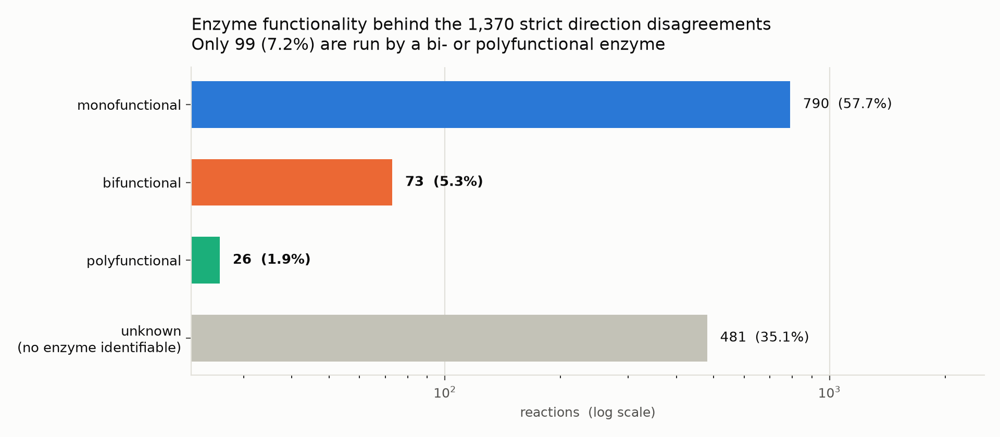
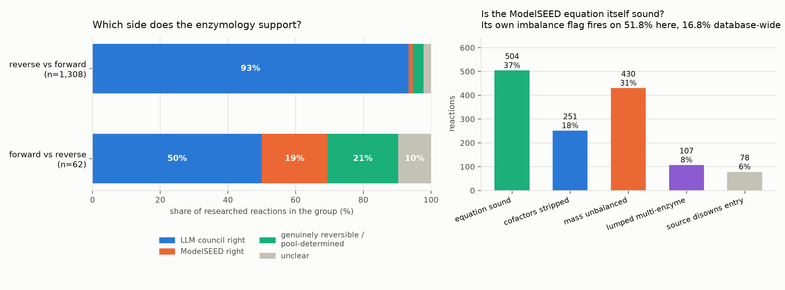

# Enzyme functionality behind the 1,370 strict direction disagreements

Built 2026-10-08 against ModelSEED `dev` @ `078a395f`
(`/scratch/ctaylor/tmp/devsnap_078a395f`), the same snapshot as
[`reports/llmVsRecommended/LLM_VS_RECOMMENDED_DIRECTION.md`](../llmVsRecommended/LLM_VS_RECOMMENDED_DIRECTION.md).

**Status: complete — 1,370 / 1,370 reactions researched, no gaps.**

## What was asked, and what came back

The LLM-vs-recommended report splits 8,466 direction mismatches into six
groups. Two of them are *strict* disagreements, where the recommendation and
the LLM council pick opposite sides rather than merely differing over whether
a reaction is bidirectional:

| group | recommended | LLM ensemble | reactions |
|---|:---:|:---:|---:|
| `forward_vs_reverse` | `>` forward | `<` reverse | 62 |
| `reverse_vs_forward` | `<` reverse | `>` forward | 1,308 |
| **total** | | | **1,370** |

The question put to the literature was: **is each of these reactions run by a
bifunctional or polyfunctional enzyme?** — the hypothesis being that an enzyme
with two fused catalytic activities might run chemistry in both senses and so
explain why two direction calls disagree.

**The answer is no, and the margin is not close.**

| | reactions | share |
|---|---:|---:|
| monofunctional | 790 | 57.7% |
| **bifunctional** | **73** | **5.3%** |
| **polyfunctional** | **26** | **1.9%** |
| unknown (no enzyme identifiable) | 481 | 35.1% |
| **bi- or polyfunctional, combined** | **99** | **7.2%** |



Only 50 of the 99 multifunctional calls are high-confidence, and only 35 carry
a note saying the multifunctionality bears on the *direction* at all. So the
honest headline is that **multifunctional enzymes explain a few dozen of 1,370
disagreements, not the phenomenon.**

The recurring genuine cases are worth having: lactase-phlorizin hydrolase (6
reactions, two distinct glycosidase sites on one chain), DNA polymerase I (4,
polymerase + two exonucleases), aphidicolan-16β-ol synthase (3, fused class
II/class I diterpene cyclase), class A PBPs (3, transglycosylase +
transpeptidase). The single cleanest case where bifunctionality really does
drive the conflict is **`rxn55967`**, a 1-testosterone hydratase/dehydrogenase
whose dehydrogenase half pulls the hydration forward, and **`rxn50031`**
(PaaZ), whose fused ALDH domain irreversibly consumes the hydratase domain's
product.

## What actually explains the disagreements

Having searched all 1,370 reaction-by-reaction, the dominant finding is a
different one, and it replicated in every chunk independently.

### 1. The enzymology almost always sides with the LLM council — but only in one group

| group | n | LLM right | ModelSEED right | genuinely reversible | unclear |
|---|---:|---:|---:|---:|---:|
| `forward_vs_reverse` | 62 | 31 (50%) | **12 (19%)** | 13 (21%) | 6 (10%) |
| `reverse_vs_forward` | 1,308 | **1,221 (93%)** | 17 (1%) | 41 (3%) | 29 (2%) |

**These are two different phenomena and must not be pooled.** The small group
is a genuine mixed bag where ModelSEED is often right (Renilla luciferin
sulfotransferase really does desulfate; succinate:quinone oxidoreductase
really is named misleadingly). The large group is a near-systematic failure.

### 2. More than half of these equations are broken, and ModelSEED already knows

`equation_defect`, assigned per reaction from the literature:

| | reactions |
|---|---:|
| equation sound | 504 (36.8%) |
| mass unbalanced | 430 |
| cofactors stripped | 251 |
| lumped multi-enzyme | 107 |
| source disowns the entry | 78 |
| **carrying some defect** | **866 (63.2%)** |

This is corroborated by a check that needs no literature and no model
judgment — ModelSEED's own `status` field:

| set | flagged mass/charge imbalanced |
|---|---:|
| all non-obsolete reactions (baseline) | 8,125 / 48,384 = **16.8%** |
| all 8,466 recommended-vs-LLM mismatches | 1,128 = **13.3%** |
| **the 1,370 strict disagreements** | **710 = 51.8%** |

**3.1× the database baseline.** Note that general disagreement is *not*
enriched (13.3%, below baseline) — broken stoichiometry travels specifically
with strict, opposite-direction conflicts.



### 3. ModelSEED's recommendation contradicts its own primary source

The snapshot ships a MetaCyc dump under `Provenance/MetaCyc/`, whose equations
carry the arrow MetaCyc itself asserts. For the 709 strict reactions that
resolve there:

| | count | share |
|---|---:|---:|
| MetaCyc writes `=>` (irreversible forward), ModelSEED recommends `<` | **491** | **69.3%** |
| MetaCyc's direction agrees with the **LLM council** | 502 | **70.8%** |
| MetaCyc's direction agrees with the **recommendation** | 45 | **6.3%** |

This is the strongest result here because no LLM judgment enters it. Where the
source database has an opinion, the thermodynamic cascade overrides it and is
wrong roughly eleven times out of twelve.

Separately, of the 190 reactions carrying a stored `direction` field, **184
(97%) say `=` (reversible)** and were overridden to a strict direction.

### 4. A confident grade on a broken equation

| thermo grade | n | ModelSEED flags the equation imbalanced |
|---|---:|---:|
| **gold** | 49 | **36 (73%)** |
| silver | 422 | 188 (45%) |
| bronze | 899 | 486 (54%) |

Gold — the *highest*-confidence tier — has the *worst* imbalance rate. The
grade certifies the number's self-consistency, not the chemistry's validity.
`rxn14318` is the worked example: gold, self-certain, corroborated, on a
reaction KEGG itself annotates "unclear reaction" with no EC and no orthology.
This is the same conclusion `reports/thermoSourceMethod/` reached from a
different direction — *grade is a trust label, not a selector*.

### 5. Specific, mechanically fixable defect classes

- **Dropped products that already exist in the database.** 349 reactions
  (25%) have a mass residual matching an existing compound exactly — most
  often oxidised glutathione `cpd00111` (39 reactions, independently found by
  hand in five separate chunks), ADP `cpd00008` (16), CO₂ (13), PPi (9), O₂
  (9). These are import bugs with the counterpart sitting in the compound
  table, not research problems. *Caveat: formula matching cannot distinguish
  isomers, so entries like "D-Glucose" are candidates, not confirmations.*
- **Orphan ADP.** 17 reactions carry a residual of exactly one or three whole
  ADP molecules. **That is 17 of the 21 such cases in the entire database
  (81%)** — 28.6× enriched.
- **dGPredictor has the wrong sign on SAM methyl transfer.** Of 93
  SAM-containing reactions here, **92 (99%) get a positive ΔG**, median
  **+32.8 kJ/mol**, for chemistry that is ~−60 kJ/mol. The values repeat
  verbatim (29.04 ×11, 32.81 ×10, 32.25 ×10), so a handful of mis-signed
  class-level group estimates are flipping dozens of reactions each.
- **Free FAD/FADH₂ standing in for ETF/quinone coupling.** The single most
  reported `cofactors_stripped` pattern, hitting acyl-CoA
  dehydrogenases/oxidases across at least a dozen chunks. Removing the
  electron sink is exactly what removes the irreversibility.
- **Combinatorial expansions.** 126 reactions (9.2%) are generic-reaction
  expansions (`.metaexp.`, `.chlamyexp.`, `.maizeexp.`) that pair
  non-corresponding substrate and product instances — e.g. a tricyclic C20
  diterpene aldehyde "oxidised" to a straight-chain C20 fatty acid. Only
  **1.4× enriched**, so expansions are not themselves a cause of strict
  disagreement; they are simply reliably broken when they do appear.

## Zooming into the 504 reactions with a sound equation

Section 2 split the 1,370 into 504 (36.8%) with no `equation_defect` and 866
(63.2%) carrying one. The 504 are the cleanest possible test of the
recommendation cascade: there is no bad stoichiometry to blame, so whatever's
wrong is the direction call itself, not the data it was computed from.

### The shape of the 504

| | forward_vs_reverse (35) | reverse_vs_forward (469) |
|---|---:|---:|
| literature says the **LLM** is right | 23 (66%) | 442 (94%) |
| literature says **ModelSEED** is right | 9 (26%) | 10 (2%) |
| genuinely reversible / no side favoured | 0 | 14 (3%) |
| unclear — no enzyme identifiable either way | 3 (9%) | 3 (1%) |

Pooled: **465/504 (92.3%)** side with the LLM, **19 (3.8%)** with ModelSEED,
**14 (2.8%)** are genuinely reversible, **6 (1.2%)** unclear. The two groups
still should not be pooled for interpretation (56% of `forward_vs_reverse` is
defect-free vs. 36% of `reverse_vs_forward`, and the small group is a real
mixed bag), but once an equation is confirmed sound, *both* groups lean
toward "LLM right" — it's a matter of degree (66% vs. 94%), not direction.

Why, mechanically, if not a broken equation: the recommendation is built on
weak evidence stated with unwarranted confidence. **84.5%** of the 504 carry
a thermo self-assessment of `unconfident` and **68.1%** are `bronze` grade
(lowest trust tier) — yet all were still promoted to a *strict* directional
call instead of `=`. Only 3 of 504 (0.6%) are `gold` grade, and even those
are wrong (MTAP, ADC synthase, and PhzE/ADIC synthase — see below). By
source: **dGPredictor drove 59.3%** of the 504, **eQuilibrator 40.1%**, and
**Group Contribution essentially none** — the same two ML/computed sources
implicated throughout this report, never the simpler legacy method.

### The 19 where the literature actually backs ModelSEED

Not every "strict disagreement" is a cascade failure. Four of the 19 are the
**same enzyme family**: succinate:quinone oxidoreductase / respiratory
complex II (`rxn09272`, `rxn37562`, `rxn37563`, `rxn58717`). Each entry is
*named* "fumarate reductase" while the *equation* is written as succinate
oxidation against a high-potential ubiquinone acceptor — the redox chemistry
favours the written (forward) direction, and the council most plausibly
read the name rather than the equation. Two more
(`rxn07646`, `rxn11574`, lycopene β-cyclase) also appear in the bifunctional
list above: the fused phytoene-synthase/cyclase domain is *why* the
committed, ModelSEED-matching direction is correct here — one of the few
places multifunctionality earns its keep on the direction question, not just
the enzyme classification.

### The 20 that are genuinely reversible, not "wrong"

14 `neither` + 6 `unclear`. A recurring cluster: BAHD-family
hydroxycinnamoyl-CoA transferases (`rxn01572`, `rxn05136`, `rxn48947`,
HCT/HQT) are demonstrably near-equilibrium in vitro — direction is set by the
acyl-CoA/acceptor pool, not the enzyme's mechanism — plus a proton-coupled
cysteine transporter and two spontaneous tautomeric/chemical equilibria
(a carbinolamine ring-chain tautomerisation, a sulfide-driven arsenical
interconversion). For these, forcing a strict `>` or `<` is itself the wrong
modelling choice, independent of which thermo source made the call.

### Why the LLM is right on the other 465: mining the direction rationale

Each researched reaction carries a `direction_conflict.note` written
specifically about the direction verdict — separate from the top-level
`rationale`, which is about the mono/bi/polyfunctional call and must not be
conflated with it (an enzyme's *functionality* reasoning and its *direction*
reasoning answer different questions; mining the two together earlier
undercounted real direction mechanisms, since functionality text like "a
single catalytic activity" kept matching before the direction note did).

Keyword-tagging `direction_conflict.note` for the 465 LLM-correct,
equation-sound reactions surfaces ten candidate thermodynamic/mechanistic
drivers (a reaction can match more than one; 60.6% match at least one,
`scripts/analyze_strict_disagreement_sound_subset.py`):

| mechanism (text-mined signal) | n | share |
|---|---:|---:|
| named canonical pathway role (salvage/biosynthesis/catabolism) | 175 | 37.6% |
| pathway channeling / downstream consumption (pull) | 65 | 14.0% |
| dehydration / hydration / elimination / condensation | 56 | 12.0% |
| ATP/NTP or phosphoanhydride coupling | 25 | 5.4% |
| redox-partner / quinone potential mismatch | 23 | 4.9% |
| spontaneous / non-enzymatic step involved | 18 | 3.9% |
| hydrolysis of a high-energy / glycosidic bond | 14 | 3.0% |
| empirically measured / experimentally observed direction | 13 | 2.8% |
| O2-dependent oxygenation/oxidation | 12 | 2.6% |
| cyclization / carbocation / terpene chemistry | 12 | 2.6% |
| decarboxylation (CO2 loss) | 5 | 1.1% |

This is a text-mining signal, not a chemistry ontology — it's reported as
one, not presented as exhaustive (183 of 465, 39.4%, match none of these
patterns and are case-specific enzymology: a named enzyme with a
documented-but-not-generalisable activity). The single biggest bucket,
"named canonical pathway role," is itself a catch-all: the recurring honest
answer in the raw notes is closer to *"this is just how the characterised
enzyme is documented to run,"* not a single textbook rule. The more specific
categories below it are where a generalisable chemical principle really is
doing the work.

### What enzyme(s) actually impose the direction, thermodynamically

Clustering the 465 by enzyme family (ordered substring match on
`enzyme_name`) and crossing each family against which thermo source produced
the wrong call found three near-pure clusters. Pushing further — searching
the reaction *equation* itself for cofactor/motif signatures, not just the
enzyme name — found two more, and showed the first glucosidase count was an
undercount. All five turn out to be **two defect classes**, not five
unrelated enzyme families:

![Horizontal bar chart of the five systematic clusters plus the residual among the 465 LLM-correct, equation-sound reactions, grouped and coloured by defect class: the eQuilibrator cluster (blue, bottom) is quinone/quinol-coupled redox and glycoside hydrolases; the dGPredictor cluster (orange, middle) is PAPS sulfotransferase, ATP/phosphate-coupled group transfer, and SAM methyltransferase; the residual (grey, top) is 248 reactions of case-specific enzymology with no further single-mechanism pattern found.](figures/strict_disagreement_sound_families.png)

**dGPredictor mis-signs activated-cofactor group transfer — 151 reactions (32.5%):**

| cluster | n | purity | the chemistry |
|---|---:|---:|---|
| SAM-dependent methyltransferase | **81** | **99%** | SAM's sulfonium centre is a high-energy methyl donor; methylation is essentially irreversible (cellular SAH-hydrolase scavenging pulls it further). The same defect [section 5](#5-specific-mechanically-fixable-defect-classes) already names ("dGPredictor wrong sign on SAM methyl transfer," 92/93 positive ΔG). |
| PAPS-dependent sulfotransferase | **35** | **100%** | PAPS → PAP is the sulfate-chemistry analogue of SAM → SAH: a high group-transfer-potential cofactor whose sulfation direction is physiologically one-way (reverse "desulfation" is a separate sulfatase, not this enzyme backward). |
| ATP/ADP/phosphate-coupled group transfer | **35** | **89%** | Found by searching the *equation*, not the enzyme name — it spans kinases, synthetases, ligases, an amidinotransferase, even a monooxygenase. The common thread is a phosphoanhydride bond (ATP→ADP+Pi), the same "activated cofactor" chemistry as SAM and PAPS, just not confined to one named enzyme family. |

SAM, PAPS, and ATP are mechanistically the same category — an activated,
high-group-transfer-potential cofactor driving an essentially irreversible
transfer. One mis-assigned group contribution for *that kind of bond* would
explain all three at once, which is consistent with how total and uniform
the purity is (89–100%) across three otherwise unrelated enzyme superfamilies.

**eQuilibrator mis-estimates specific structural motifs — 66 reactions (14.2%):**

| cluster | n | purity | the chemistry |
|---|---:|---:|---|
| Glycoside hydrolase (broad) | **54** | **100%** | **Corrected from the 43 first reported**: matching only the literal substring `"glucosidase"` missed glucuronidase, rhamnosidase, and other GH-family hydrolases — the *same* mechanism (hydrolyse-only; glycoside biosynthesis is a separate UDP-sugar-dependent transferase) under a different name. The broader, mechanism-based match is still **100% eQuilibrator**. |
| Quinone/quinol-coupled redox | **12** | **100%** | Succinate:quinone oxidoreductase variants, phytoene desaturase, NAD(P)H:quinone oxidoreductase, tetrathionate reductase — different enzymes, same redox couple. **Independently corroborated**: `quinone redox is the real failure` is the same conclusion a separate piece of this project's work reached comparing eQuilibrator against a retrained dGPredictor (see memory `project_eq_vs_dgpredictor_modelseed`). |

**151 + 66 = 217 of 465 (46.7%)** traces to just two systematic defects, each
dominated by one thermo source, each spanning multiple otherwise-unrelated
enzyme families. Practically: fixing dGPredictor's sign/direction convention
for activated-cofactor group transfer (SAM, PAPS, ATP alike), plus
revisiting how eQuilibrator estimates ΔG′° for glycosidic-bond hydrolysis and
the quinone/quinol couple, would resolve nearly half of the 465 in two
changes, without touching a single stoichiometric equation.

### The other 53.3%: no *sixth large* cluster

> **Superseded in part.** This subsection's claim that the residual holds
> "no further single-mechanism bug" is true only at the scale searched here
> (clusters the size of the big five). A finer search — ranking enzyme-name
> tokens by thermo-source purity instead of matching guessed chemistry —
> finds **ten smaller sub-clusters covering 78 of the 248 (31.5%), eight of
> them 100% single-source**. See
> [Inside the residual](#inside-the-residual-ten-sub-clusters-and-the-same-ones-in-every-population).
> The tested-and-rejected novelty hypothesis below still stands.

The remaining **248 reactions (53.3%)** are the true residual after claiming
reactions to the five clusters above in priority order (no double-counting).
Two things are worth knowing about them:

- **Their profile is statistically indistinguishable from the full 504** —
  69% bronze grade, source split ~55/45 dGP/eQ, confidence and research-tier
  mix all close to the whole-dataset baseline. There is no further single
  mechanical bug hiding in this group; it did not just need a sixth cluster.
- **A tested hypothesis that did NOT hold**: molecular novelty. The obvious
  next guess is that the residual is disproportionately "exotic" secondary
  metabolite chemistry underrepresented in the thermo sources' training
  data. It isn't — a plant/fungal/secondary-metabolite signal in
  `organism_context`/`pathways` is actually **more common inside the five
  clusters (45%)** than in the residual (24%), because plant secondary
  metabolism happens to lean heavily on SAM-methyltransferases and glycoside
  hydrolases. Reported here because it was checked, not because it worked.

What the residual's direction notes *do* say, concentrated more than in the
465 as a whole, is "named canonical pathway role" (39.2% vs. 37.6%) and
"pathway channelling / downstream pull" (16.5%) — the textbook limitation of
any standard-state ΔG′° estimate: these sources compute free energy at 1 M
reference concentrations, not real cellular ones, so a reaction that looks
marginal (or even wrong-signed) at standard state can still run firmly
forward in vivo when its product is immediately consumed by the next pathway
enzyme or its substrate pool is kept high. No *large* second bug is hiding
here. (The finer pass linked above does find ten small source-pure pockets
covering 31.5% of these 248; the 170 that survive even that search are the
individually-documented enzymes whose physiological direction was never
recoverable from a standard-state ΔG′° alone.)

*(Figure and all tables in this subsection: `scripts/analyze_strict_disagreement_sound_subset.py`
→ `results/strict_disagreement_enzymes/sound_subset_clusters.tsv` /
`sound_subset_analysis.json` (`systematic_clusters`,
`systematic_clusters_residual`); figure drawn by
`scripts/plot_strict_disagreement_sound_families.py`, registered in
`scripts/figures.tsv` as `strict_disagreement_sound_families`. The
generic enzyme-family breakdown — including the mixed-source families used
as a contrast earlier (dehydrogenase, isomerase, lyase, reductase, hydratase)
— is still in `sound_subset_families.tsv` / `llm_sound_enzyme_families`.)*

### What biological pathways the 248 residual reactions actually belong to

No further thermo-source *mechanism* was hiding in the residual, but that
doesn't mean the 248 are a random scatter of central metabolism. Each
reaction's `pathways` field (KEGG + MetaCyc, populated for 155/248) was
pulled and bucketed by keyword; the 93 without one got a weaker fallback pass
over `enzyme_name`/`rationale`/`organism_context` (22 more recovered that
way). Over half the residual sits in just two biological networks:

![Horizontal stacked bar chart of the 248 residual reactions by biological pathway category. Xenobiotic/pollutant biodegradation (86, 35%) and secondary metabolite biosynthesis (40, 16%) are the two largest named categories; "no pathway identifiable" (76, 31%, grey) is the next largest; the rest -- amino acid, cofactor/vitamin, fatty acid/lipid, glycan, steroid, nucleotide, and carbohydrate metabolism -- are small. Bars are split into a darker segment (curated KEGG/MetaCyc annotation) and a lighter segment (text-inferred, no curated annotation).](figures/strict_disagreement_residual_pathways.png)

| pathway category | n | share | dominant source |
|---|---:|---:|---|
| **Xenobiotic / pollutant biodegradation** | **86** | **34.7%** | dGP (59), eQ (27) |
| No pathway identifiable | 76 | 30.6% | mixed |
| **Secondary metabolite biosynthesis** (plant/microbial) | **40** | **16.1%** | eQ (24), dGP (16) |
| Amino acid metabolism | 18 | 7.3% | dGP (12), eQ (6) |
| Cofactor / vitamin / coenzyme biosynthesis | 7 | 2.8% | mixed |
| Fatty acid / lipid metabolism | 6 | 2.4% | eQ (5) |
| Nucleotide metabolism | 4 | 1.6% | mixed |
| Steroid / sterol / bile-acid metabolism | 4 | 1.6% | eQ (4) |
| Glycan / cell-envelope metabolism | 4 | 1.6% | mixed |
| Carbohydrate / central carbon metabolism | 3 | 1.2% | dGP (3) |

**#1, bacterial xenobiotic/pollutant catabolism (86, 34.7%)** — a single
coherent biological network, not a grab-bag:

| sub-theme | n |
|---|---:|
| chlorinated aromatics (chlorobenzene/chlorocatechol/**chloromuconate cycloisomerase**/PCB-type) | 37 |
| other halogenated/aromatic (fluorobenzoate, mercury detox, drug metabolism/P450, thiocyanate, nicotine, caprolactam) | 18 |
| PAHs (naphthalene, toluene, polycyclic aromatics) | 16 |
| pesticides/herbicides (atrazine/triazine, DDT) | 11 |
| nitroaromatics | 4 |

The enzymology is dehalogenases, ring-cleavage dioxygenases/hydrolases, and
cycloisomerases (e.g. `rxn43905`/`rxn47607`/`rxn03693`, chloromuconate
cycloisomerase variants; `rxn00428`, dichloromethane dehalogenase/GST;
`rxn03485`, NahD naphthalene degradation) — classic environmental-microbiology
catabolic pathways, each usually characterised from a single soil/environmental
isolate study, often decades old.

**#2, plant/microbial secondary metabolite biosynthesis (40, 16.1%)**:

| sub-theme | n (overlapping) |
|---|---:|
| phenylpropanoid/flavonoid/flavonol | 12 |
| terpenoid/carotenoid | 8 |
| antibiotic/phytoalexin | 8 |
| alkaloid | 4 |
| other (polyketide, lignan, glucosinolate, N/S-containing secondary compounds) | 36 |

The same biological space as the SAM-methyltransferase and glycoside-hydrolase
defect clusters above — this is the fraction of plant/microbial specialised
metabolism that *isn't* explained by either of those two specific defects.

**Why this refines, rather than contradicts, the rejected hypothesis above**:
the earlier test asked whether specialised/novel chemistry is concentrated
*in* the residual rather than the clusters, and it isn't (45% vs. 24%) — the
clusters are, if anything, more plant-secondary-metabolism-heavy. This
section asks a different question — what *is* in the residual, on its own
terms — and the answer is that over half of it (126/248, 50.8%) is exactly
the kind of chemistry most likely to be sparse in any thermo source's
training data: one-off environmental-pollutant degradation pathways and
plant/fungal specialised metabolites, each usually characterised in a single
old paper rather than as part of a large, well-studied reaction family. Both
observations are true at once: novelty predicts *disagreement* strongly
(pulling in both the clusters and most of the residual), but it does not by
itself predict *which thermo source* produces the wrong confident answer —
that part is the coverage/uncertainty asymmetry described above.

The remaining **76 (30.6%)** have no identifiable pathway even after the
text-mining fallback — genuinely assorted orphan/legacy enzymology (murein
endopeptidases, ferritin ferroxidase, jasmonate biosynthesis, penicillin
acylase), with no further single theme.

*(Figure and tables: `scripts/analyze_strict_disagreement_residual_pathways.py`
→ `results/strict_disagreement_enzymes/residual_pathways.json` / `.tsv`;
figure drawn by `scripts/plot_strict_disagreement_residual_pathways.py`,
registered in `scripts/figures.tsv` as
`strict_disagreement_residual_pathways`.)*

## Classifying disagreement on ModelSEED's OWN status flag, not literature judgment

Everything above filters "sound" by `equation_defect`, a literature verdict.
A sharper, assumption-free cut uses the **database's own automated
mass/charge-balance check** (`modelseed_status`) instead: keep only
reactions ModelSEED itself does not flag as mass-imbalanced.

| `modelseed_status` tokens | meaning | n (of 1,370) | kept? |
|---|---|---:|:---:|
| `OK` | fully balanced | 660 | ✅ |
| `CI` | charge-imbalanced, mass already balanced | 219 | ✅ |
| `MI` | mass-imbalanced | 150 | ❌ |
| `CI+MI` | mass- and charge-imbalanced | 341 | ❌ |

This gives two populations, analysed identically
(`scripts/analyze_strict_disagreement_balanced_populations.py`):
**OK-or-CI-only (879)** and the stricter **OK-only, no flags at all (660)**.

Neither *population* is a subset of the 504 equation-sound set above — they
are cut on a different axis, and 18 literature-sound reactions carry a
database flag (17 `CI+MI`, 1 `MI`). But the sets this section actually
compares — the equation-sound, LLM-correct, and residual subsets *within*
each population — **are strictly nested**, and that matters for how much
the agreement between them is worth:

| | all 1,370 | OK or CI-only | OK only | nested? |
|---|---:|---:|---:|:---:|
| population rows | 1,370 | 879 | 660 | ✅ 660 ⊆ 879 ⊆ 1,370 |
| equation-sound | 504 | 486 | 476 | ✅ 476 ⊆ 486 ⊆ 504 |
| …and LLM-correct | 465 | 448 | 438 | ✅ 438 ⊆ 448 ⊆ 465 |
| …residual after the 5 clusters | 248 | 242 | 233 | ✅ 233 ⊆ 242 ⊆ 248 |

Nothing ever enters a stricter population that was absent from a looser one
(`gained = 0` at every level, verified in
`analyze_strict_disagreement_residual_subclusters.py`). That is forced: each
population is a row-subset of the one before it, and every filter applied
downstream — `equation_defect == "none"`, `enzymology_supports == "llm"`,
the five cluster predicates — is a pure per-reaction predicate, so it
commutes with subsetting. The 18-reaction "disagreement" between the filters
is exactly the one-way nesting gap 504 → 486, not a crossover.

**Read the three-panel comparison below accordingly.** It is a real
robustness check on one thing — whether the clusters are *concentrated* in
the reactions a balance filter removes, which would make them an artifact of
dirty stoichiometry — and they are not. It is **not** three independent
re-derivations: the panels share 94% of their reactions by construction and
could not have disagreed much.

### Who's right barely moves

| population | n | LLM right | ModelSEED right | neither | unclear |
|---|---:|---:|---:|---:|---:|
| all 1,370 | 1,370 | 1,252 (91.4%) | 29 (2.1%) | 54 (3.9%) | 35 (2.6%) |
| **OK or CI-only** | **879** | **804 (91.5%)** | 24 (2.7%) | 36 (4.1%) | 15 (1.7%) |
| **OK only** | **660** | **600 (90.9%)** | 23 (3.5%) | 27 (4.1%) | 10 (1.5%) |

Excluding every mass-imbalanced reaction barely changes the headline split.
**Mass imbalance is not why the recommendation is usually wrong** — it's a
*correlate* (enriched 3.1× in the full 1,370, section 2 above), not the
mechanism. Something else is driving the 90%+ failure rate even when the
stoichiometry is completely clean.

### Why: two populations, two different dominant defects

| | equation sound | cofactors stripped | mass unbalanced (literature) | source disowned | lumped multi-enzyme |
|---|---:|---:|---:|---:|---:|
| OK or CI-only (879) | 486 (55.3%) | 204 (23.2%) | 120 (13.7%) | 51 (5.8%) | 18 (2.0%) |
| OK only (660) | 476 (72.1%) | 120 (18.2%) | 8 (1.2%) | 41 (6.2%) | 15 (2.3%) |
| CI-only (219, the difference) | 10 (4.6%) | 84 (38.4%) | 112 (51.1%) | 10 (4.6%) | 3 (1.4%) |

The literature re-derives a "mass unbalanced" verdict for 120 of the 879
despite ModelSEED's own checker saying the formulas sum correctly — and
**112 of those 120 (93%) are concentrated entirely in the 219 CI-flagged
reactions** (51.1% of CI-only, vs. 1.2% of OK-only). Reading the actual notes
for those 112 (`modelseed_status` always `CI`, never `OK`):

- **97% (109/112) explicitly describe a redox-cofactor bookkeeping error**,
  and **96% (108/112) involve a NAD(H)/NADP(H)/FAD-family cofactor**. Two
  recurring patterns: a **bare half-reaction** with the cofactor and nothing
  else (`rxn12950`: `NADH => NAD`, a "free NADH sink" with no real substrate
  pair — the committed memory on this pipeline already names this as a
  stripped-substrate bug, see `project_ci_only_charge_fixes`), and an
  **oxidized/reduced form written on the wrong side** (`rxn07326`,
  `rxn07329`: ModelSEED pairs NADP⁺ with the *reduced* sterol and NADPH with
  the *oxidized* one, inverting the apparent redox direction and, with it,
  the sign of the thermodynamic estimate the cascade trusts).
- The LLM council is right on **106/112 (95%)** of these — never ModelSEED.
  ModelSEED's own charge-imbalance flag is, in effect, already pointing at
  the broken bookkeeping; the cascade just doesn't use that signal to
  abstain.
- This sits alongside, and is mechanistically the same family as, the 84
  **`cofactors_stripped`** CI-only reactions (e.g. `rxn02017`, `rxn07790`,
  `rxn07791`) where the NAD(P)⁺/NAD(P)H pair is dropped **entirely**, not
  just misassigned — same failure mode, different severity. Together,
  **196/219 CI-only reactions (89.5%)** are one of these two redox-cofactor
  defects. **Charge imbalance in this dataset is overwhelmingly a symptom of
  a mishandled redox cofactor, not an independent data-quality issue.**

The 8 OK-only "mass unbalanced" reactions are a different, much smaller
phenomenon: combinatorial-expansion templating bugs that happen to still
balance formulaically. `rxn38853`/`rxn38902`/`rxn38973` all hydrolyse dGTP
but template the *adenine* product series (ADP/AMP) instead of the matching
dGDP/dGMP/guanine one; `rxn38863`/`rxn38866` pair N-acetyl-L-glutamate with
combinatorially mismatched amino-acid products. In every one of these the
literature verdict still sides with the LLM's direction, because the
*chemical class* (a hydrolase/kinase running essentially irreversibly) is
unambiguous even though the specific substrate/product pairing is wrong.

### The systematic thermo-source clusters are not an artifact of the sound/unsound split

Re-running the 465-reaction mechanism analysis from the section above —
mechanism-tagging `direction_conflict.note`, then the 5 non-overlapping
dGPredictor/eQuilibrator clusters — on the equation-sound, LLM-correct
subset of **each** status population reproduces it almost exactly:


| cluster | all 1,370 (n=465) | OK/CI-only (n=448) | OK-only (n=438) |
|---|---:|---:|---:|
| SAM methyltransferase | 81 | 81 | 81 |
| PAPS sulfotransferase | 35 | 35 | 35 |
| Glycoside hydrolase (broad) | 54 | 54 | 54 |
| Quinone/quinol-coupled redox | 12 | 12 | 11 |
| ATP/phosphate-coupled group transfer | 35 | 24 | 24 |
| **dGPredictor + eQuilibrator clusters, combined** | **217 (46.7%)** | **206 (46.0%)** | **205 (46.8%)** |
| Residual (case-specific) | 248 (53.3%) | 242 (54.0%) | 233 (53.2%) |

The SAM, PAPS and glycoside-hydrolase clusters are **bit-for-bit identical**
across all three populations (none of those reactions carry a flagged
imbalance either way), and the combined share explained is stable within
0.7 points. The residual's pathway breakdown is equally stable — xenobiotic
biodegradation 34.7%→35.1%→34.8%, "no pathway identifiable" 30.6%→30.2%→30.5%,
secondary-metabolite biosynthesis 16.1%→16.1%→15.9% (all 1,370 → OK/CI-only →
OK-only). **The two-defect-class finding is not an artifact of a dirty
subpopulation: the clusters are not concentrated in the reactions a balance
filter strips out.** Stated carefully — because the three panels are nested
subsets (above), the stability of these numbers is largely forced, and the
only informative content is *where* the 27 removed reactions land. They land
almost nowhere: 0 in SAM, 0 in PAPS, 0 in the glycoside hydrolases, 1 in
quinone, 11 in the ATP cluster, 15 in the residual. Had a cluster been built
on reactions ModelSEED flags as imbalanced, that cluster would have
collapsed here; none did.

### Inside the residual: ten sub-clusters, and the same ones in every population

Two questions the figure above leaves open: is its grey residual bar the
*same reactions* in each panel, and does that bar have structure of its own?

**Same reactions — exactly.** 233 ⊆ 242 ⊆ 248, nothing gained at any step
(the nesting table earlier in this section). The OK-only residual is not a
population that resembles the unfiltered one; it *is* the unfiltered one
minus 15 named reactions. Those 15 are worth reading, because they are a
clean illustration of what each filter removes:

- **248 → 242** drops 6 reactions ModelSEED flags mass-imbalanced
  (`rxn02987`, `rxn03776`, `rxn03784`, `rxn21376`, `rxn22034`, `rxn47384`) —
  all 6 dGPredictor-driven, mostly large combinatorial transferase entries
  whose formulas do not sum.
- **242 → 233** drops 9 charge-imbalanced ones, and **8 of the 9 are off by
  exactly ±2 charge** (`CI:-2` / `CI:2`) on an NAD(P)H- or proton-coupled
  redox step — `rxn04279`/`rxn04282` (monoterpene reductases),
  `rxn16011` (alcohol dehydrogenase), `rxn24592` (catalase). This is the
  same redox-cofactor bookkeeping defect diagnosed for the CI-only
  population above, reaching into the residual.

Neither filter removes a *kind* of chemistry from the residual, which is why
every number below is near-identical across the three populations.

**And the residual does have structure.** It was described earlier as having
"no further single-mechanism pattern," which was true at the scale that
search ran at — nothing the size of the SAM (81) or glycoside (54) clusters.
Searched finer, by ranking every enzyme-name token appearing ≥4 times by
thermo-source purity rather than by guessing chemistry first, **ten
sub-clusters emerge covering 78 of the 248 (31.5%)** — smaller than the big
five (4–19 reactions each), but not weaker: eight of the ten are **100%
single-source**.

**How to read this figure** — it is deliberately *one* panel where the
figure above it is three. Three panels here would be three near-copies of
the same reactions, which is exactly the nesting trap this section is
warning about; drawing it once and marking the difference is the honest
encoding:

- **solid bar** = reactions present in **all three** populations (the
  OK-only count — ModelSEED's own status flag is clean)
- **pale tip** = the reactions a stricter balance filter removes (present in
  all 1,370 but not in OK-only). Only two of the ten sub-clusters have one
  at all, one reaction each.
- **orange / blue** = which thermo source produced the wrong confident call,
  the same mapping as the five-cluster figures above
- **the strip across the top** = what the whole 248 is made of (58
  dGPredictor-pure + 20 eQuilibrator-pure sub-clustered, 170 not), on its
  own scale, because at 170 the remainder is ~9× the largest sub-cluster and
  would otherwise squash the ten bars the figure is about into the left
  tenth of the panel. Both scales start at zero; neither is broken.

![Horizontal bar chart of ten sub-clusters inside the 248-reaction residual, coloured orange for dGPredictor-pure and blue for eQuilibrator-pure, with a full-width composition strip above showing 58 dGPredictor + 20 eQuilibrator sub-clustered against 170 still unexplained. Ring aminohydrolase/hydrolytic deaminase (19) is the largest, then triple-bond hydratase (11) and chloromuconate cycloisomerase (10). Two bars carry a pale tip marking the single reaction each loses under the strictest balance filter.](figures/strict_disagreement_residual_subclusters.png)

| sub-cluster | all 1,370 | OK/CI-only | OK-only | source | purity |
|---|---:|---:|---:|---|---:|
| Ring aminohydrolase / hydrolytic deaminase | 19 | 19 | 19 | dGP | 95% |
| Triple-bond hydratase (alkyne / nitrile) | 11 | 11 | 11 | dGP | 100% |
| Chloromuconate cycloisomerase | 10 | 10 | 10 | dGP | 100% |
| *cis*-Dihydrodiol dehydrogenase | 7 | 7 | 6 | dGP | 100% |
| Epoxide hydrolase | 6 | 6 | 6 | dGP | 83% |
| Flavonol glycoside acyl / glucosyl transfer | 6 | 6 | 6 | eQ | 100% |
| Hydrolytic / reductive dehalogenase | 5 | 5 | 4 | dGP | 100% |
| Dienelactone hydrolase | 5 | 5 | 5 | eQ | 100% |
| HCCA isomerase (naphthalene, NahD) | 5 | 5 | 5 | eQ | 100% |
| Acyl-CoA dehydrogenase (β-oxidation) | 4 | 4 | 4 | eQ | 100% |
| **sub-clustered total** | **78** | **78** | **76** | | |
| still unexplained | 170 | 164 | 157 | dGP 86 / eQ 82 | — |

Across all ten sub-clusters only two rows move at all, by one reaction each
(*cis*-dihydrodiol dehydrogenase and dehalogenase, both losing a `CI`-flagged
member); the other 13 of the 15 removed reactions fall in the unexplained
remainder. So the answer to "are the OK/CI and OK-only residuals similar to
the unfiltered one" is that they are not merely similar — they are the same
reactions, and the sub-structure inside them is the same sub-structure.

**The chemistry is different from the big five.** The five systematic
clusters were activated-cofactor group transfer (SAM, PAPS, ATP) plus two
structural motifs (glycoside, quinone). These ten are **hydrolytic and
ring-rearrangement chemistry on xenobiotic substrates** — C–N hydrolysis on
a heteroaromatic ring, C–X cleavage, epoxide opening, triple-bond hydration,
ring cycloisomerisation. Cutting the residual by equation topology rather
than enzyme name says the same thing about the whole bucket, not just the
sub-clustered third:

| equation topology | n | share |
|---|---:|---:|
| hydrolysis (H₂O substrate, no cofactor) | 94 | 37.9% |
| intramolecular (no H₂O, no cofactor) | 74 | 29.8% |
| cofactor-coupled | 58 | 23.4% |
| condensation / dehydration (H₂O product) | 22 | 8.9% |

Two-thirds of the residual (168/248) is chemistry with **no cofactor at
all** — precisely the reactions for which the big five's "this cofactor's
group-transfer potential was mis-assigned" explanation has nothing to grip.

**The sharpest single observation: two consecutive steps of one pathway,
split across two thermo sources.** Chloromuconate cycloisomerase (10/10
dGPredictor) and dienelactone hydrolase (5/5 eQuilibrator) are adjacent
enzymes in the chlorocatechol *modified ortho*-cleavage pathway —
chloromuconate → dienelactone → maleylacetate, the consecutive `clcB` →
`clcD` steps of the canonical chlorocatechol gene cluster (PMID
[12218013](https://pubmed.ncbi.nlm.nih.gov/12218013/)). ModelSEED's cascade picks a
different thermo source for each step and gets the direction wrong at both,
with perfect per-step source purity. That is very hard to read as fifteen
independent judgment calls, and easy to read as two per-source coverage gaps
on the same stretch of chlorinated-aromatic chemistry. More broadly, the ten
sub-clusters claim **44 of the 86 xenobiotic-biodegradation reactions** —
over half of the residual's largest pathway bucket.

**Two hypotheses tested here that did not hold**, reported because they were
checked:

- *The residual is near-equilibrium chemistry* (small true |ΔG′°|, so
  estimator noise flips the sign) — **rejected**. Median |ΔG′°| from the
  driving source is 28.4 kJ/mol in the residual vs 32.2 in the five
  clusters, and only 10.2% of the residual is under 10 kJ/mol. The one real
  difference runs the *other* way: the residual's driving estimates carry a
  **much smaller reported uncertainty** (median σ 6.8 vs 17.5 kJ/mol). These
  are confident, precise, wrong numbers — which is worse for the cascade
  than noisy ones, because no uncertainty-based gate would catch them.
- *The residual is inflated by duplicate entries of a few enzymes* —
  **mostly rejected**. 216 distinct normalised enzyme names across 248
  reactions; 15.3% share a name with another. The "248 individually
  documented enzymes" framing holds, with one real exception —
  chloromuconate cycloisomerase appears 8 times by name (10 by the cluster
  predicate), which is exactly why it is the largest ring-chemistry
  sub-cluster.

**What this does and does not change.** It does not move the headline: 46.7%
of the LLM-correct, equation-sound disagreements still trace to the two big
defect classes, and the 170 reactions still left over (dGP 86 / eQ 82, a
near-perfect split of the residual's own baseline) remain individually
documented enzymology. What it changes is the characterisation of the other
half as unstructured. It is not unstructured — it is *finely* structured,
into many small source-pure pockets of hydrolytic and xenobiotic chemistry
rather than a few large cofactor-defined ones. For the practical question of
what to fix, that is a different and harder prescription than the big five:
not one sign convention, but per-source coverage on whole catabolic
pathways.

*(Script: `scripts/analyze_strict_disagreement_residual_subclusters.py` →
`results/strict_disagreement_enzymes/residual_subclusters.json` / `.tsv`
(nesting proof, per-population sub-cluster membership, rejected hypotheses);
figure drawn by `scripts/plot_strict_disagreement_residual_subclusters.py`,
registered in `scripts/figures.tsv` as
`strict_disagreement_residual_subclusters`.)*

### Bottom line for both populations

| | OK or CI-only (879) | OK only (660) |
|---|---|---|
| equation genuinely sound | 486 (55.3%) | 476 (72.1%) |
| → of those, LLM-correct | 448 (92.2% of sound) | 438 (92.0% of sound) |
| → explained by the 2 systematic thermo-source clusters | 206 (46.0% of LLM-sound) | 205 (46.8% of LLM-sound) |
| → unexplained residual (mostly xenobiotic/secondary-metabolism, standard-state-ΔG′° blind spots) | 242 | 233 |
| redox-cofactor bookkeeping defect (mangled or stripped) | 196 of 219 CI reactions (89.5%) | n/a (CI excluded) |
| other literature-found defect (stripped/disowned/lumped, non-redox) | ~197 | ~176 |

Removing charge-imbalanced reactions (879→660) removes almost nothing except
the 219-reaction CI population itself, whose disagreements are their own,
cleanly diagnosed phenomenon (redox-cofactor bookkeeping, 89.5% of it). What
remains in the OK-only 660 is the same story the 504-reaction equation-sound
analysis already told: ~46% of the clean, LLM-correct disagreements trace to
two specific, fixable thermo-source defects (dGPredictor on activated
cofactors, eQuilibrator on glycosidic/quinone motifs), and the other half is
individually-documented enzymology — much of it standard-state ΔG′° simply
not reflecting real intracellular pull (pathway channeling) or coverage gaps
in one-off xenobiotic/secondary-metabolite chemistry.

*(Script: `scripts/analyze_strict_disagreement_balanced_populations.py` →
`results/strict_disagreement_enzymes/balanced_population_analysis.json` /
`balanced_population_clusters.tsv`; figure drawn by
`scripts/plot_strict_disagreement_balanced_clusters.py`, registered in
`scripts/figures.tsv` as `strict_disagreement_balanced_clusters`. The earlier
OK/CI-only correctness re-tabulation alone — without the defect/cluster
breakdown — lives in `correctness_balanced.json`/`.tsv`,
`scripts/analyze_strict_disagreement_balanced_correctness.py`.)*

## Testing it directly: fix the equation, recompute the real thermodynamics

Everything above about the 219 CI-only reactions' redox-cofactor defect is
inference from reading literature notes. It's testable instead: build the
mechanically-corrected equation and ask a real thermodynamic calculation
whether it now agrees with the LLM.

**The fix.** ModelSEED defines NAD/NADH and NADP/NADPH with **identical
formulas** (only charge differs — the same convention
[`scripts/fix_ci_only_reactions.py`](../../scripts/fix_ci_only_reactions.py)
already exploited for the 389-reaction CI-only charge fix in
[[project_ci_only_charge_fixes]]). That means swapping or rescaling such a
pair's coefficients can *only* change the equation's net charge, never its
mass — so for each of the 219, `scripts/find_strict_disagreement_redox_fixes.py`
searches every same-formula pair present in the equation for the **unique**
new assignment that exactly zeros the whole equation's net charge while
leaving every other term untouched, then rebuilds the full term list and
re-verifies mass+charge balance from scratch (zero-blast-radius, same
discipline as the earlier fix). This generalizes the earlier method from pure
rescaling to also catch **side swaps** — e.g. `rxn07326`/`rxn07329`, where
NADP⁺/NADPH are assigned to the chemically backward sides; the solver finds
exchanging them is the *only* integer fix that clears the charge residual,
with no literature note consulted to find it.

| outcome | n (of 219) |
|---|---:|
| **solved** — unique cofactor-pair fix found, verified end-to-end | **103 (47.0%)** |
| ambiguous (>1 pair could explain it) | 0 |
| unresolved | 116 (53.0%) |

Zero ambiguous cases, and the unresolved 116 are exactly what the method
*should* fail on: bare half-reactions like `rxn12950` (`NADH => NAD`, nothing
else) have no second term to balance against — solving the same equation
confirms algebraically (not just by inspection) that no integer solution
exists, matching the earlier finding that these need an invented substrate,
not arithmetic. 96 of the 103 solved fixes are a **swap** (backward
assignment), 7 a **rescale** (magnitude only) — confirming the dominant
defect really is "wrong side," not "wrong amount."

**Pricing the fix with eQuilibrator 3.0.** Each of the 103 fixed equations
was handed to a live, local `equilibrator-api` component-contribution run
(`eq3` conda env, same calling convention as
[`scripts/estimate_directions_eq3.py`](../../scripts/estimate_directions_eq3.py))
— both the *original* and *fixed* stoichiometry, so the comparison is a real
calculation, not a sign flip derived by hand.

| | n |
|---|---:|
| original equation: eQuilibrator's own balance check refuses it | **29/29 (100%)**, where computable at all |
| fixed equation maps to a compound eQuilibrator recognises | 29 / 103 |
| ...with a physically plausible `|ΔG′°| ≤ 200 kJ/mol` | **7 / 29** |

eQuilibrator's balance check is independent of ModelSEED's — it uses its own
compound structures — and it refuses the *original* equation every single
time it can attempt one at all. That's an independent confirmation the
original equations really are nonsensical as written, not just a ModelSEED
bookkeeping quirk. The other 22 of 29 give physically impossible values
(+289 to +687 kJ/mol — no single enzymatic step runs at that energy): all 22
are the **same generic, templated `aldehyde dehydrogenase [NAD(P)+]`**
combinatorial-expansion entry, consistent with this report's own earlier
finding that such expansions pair non-corresponding substrate/product
instances — a *different*, already-documented defect riding along in the
same reactions, not a flaw in the cofactor fix itself.


**The result, for the 7 where a trustworthy number exists:**

| reaction | enzyme | fix | fixed ΔG′° (kJ/mol) | eQ3 call | LLM | ModelSEED (orig.) |
|---|---|---|---:|:---:|:---:|:---:|
| `rxn35387` | coproporphyrinogen III oxidase | rescale (NADP/NADPH ×2→×1 net) | −148.3 | **forward** | forward | reverse |
| `rxn35386` | coproporphyrinogen I shunt oxidation | rescale | −148.3 | **forward** | forward | reverse |
| `rxn36496`¹ | phenylacetaldehyde dehydrogenase | swap | −69.0 | **forward** | forward | reverse |
| `rxn36497`¹ | phenylacetaldehyde dehydrogenase | swap | −69.0 | **forward** | forward | reverse |
| `rxn07329` | Δ24-sterol reductase | swap | −52.9 | **forward** | forward | reverse |
| `rxn00809` | aldose reductase (galactose/galactitol) | swap | −14.9 | = (near-eq.) | forward² | reverse |
| `rxn07326` | 3-keto-steroid reductase | swap | +4.1 | = (near-eq.) | forward | reverse |

¹ `rxn36496`/`rxn36497` also carry the *separate*, already-known combinatorial-expansion
defect (the recorded product is "octanoate," not phenylacetate — the literature
note independently confirms the true product) — the cofactor fix is still
valid and the sign still corroborates the LLM, but the magnitude shouldn't be
over-trusted since the substrate/product identity itself is templated wrong.

² the original literature verdict for `rxn00809` was `enzymology_supports: neither`
("neither stored direction is trustworthy **as written**" — the note explicitly
flags the redox-mangled equation, not a claim that the enzyme itself is
reversible). A fresh, independently-computed near-equilibrium call on the
*fixed* equation is a clean three-way corroboration (literature doubt →
"neither direction, as written, is meaningful"; my arithmetic fix → closest
a real calculation can get to "as it should be written"; eQuilibrator →
weakly forward, below its own significance threshold) rather than a conflict.

**Bottom line: of every reaction where this could actually be tested end to
end — mechanically fixed, independently verified mass+charge-exact, priced by
a live thermodynamic calculation with a plausible magnitude — the corrected
thermodynamics sided with the LLM 5/5 times it gave a confident call (100%),
and 0/5 with ModelSEED's original recommendation.** The sample is small by
construction (most ModelSEED compounds, especially the sterols and secondary
metabolites common in this dataset, aren't linked to a KEGG/ChEBI/BiGG/MetaNetX
id eQuilibrator can resolve — a coverage limit, not a chemistry failure), but
every stage of the funnel is independently checkable, and nothing in the
funnel required trusting a literature note to decide *which way* to fix the
equation — the charge-balance arithmetic alone picked the swap.

*(Script: `scripts/find_strict_disagreement_redox_fixes.py` (must run in the
`eq3` conda env: `equilibrator-api 0.7.0`) →
`results/strict_disagreement_enzymes/redox_fix_outcomes.json` / `.tsv`,
`redox_fix_summary.json`; figure drawn by
`scripts/plot_strict_disagreement_redox_fix_funnel.py`, registered in
`scripts/figures.tsv` as `strict_disagreement_redox_fix_funnel`.)*

## The 481 `unknown` calls

These are honest, not unresearched. They break down as: reactions KEGG or
MetaCyc explicitly disowns ("unclear reaction", "incomplete reaction",
"spontaneous", "multi-step"), entries whose source record has been *withdrawn*
upstream (several confirmed 404 at `rest.kegg.jp`), genuinely non-enzymatic
chemistry (spontaneous lactonisations, autoxidations, thermal rearrangements,
the previtamin D₃ → vitamin D₃ sigmatropic shift), lumped multi-enzyme
segments with no single catalyst, and legacy activities measured once in
1950s–70s crude extracts and never cloned. By tier: 270 `xref_only`, 179
`named`, 32 `opaque`.

## Files

```
results/strict_disagreement_enzymes/
  strict_disagreement_enzymes.json   the deliverable -- all 1,370 reactions
  summary.json                       every count and cross-check in this report
  sound_subset_analysis.json         deep-dive on the 504 defect-free reactions:
                                      enzymology/confidence/grade/source splits,
                                      enzyme-family clustering, mechanism tags,
                                      the 5 systematic clusters + residual
                                      characterisation (incl. the rejected
                                      secondary-metabolism hypothesis test)
  sound_subset_families.tsv          figure source data: generic enzyme-family
                                      breakdown (supplementary contrast table)
  sound_subset_clusters.tsv          figure source data: the 5 non-overlapping
                                      systematic clusters + residual (headline chart)
  residual_pathways.json             biological pathway/network breakdown of the
                                      248 residual reactions, by KEGG/MetaCyc
                                      annotation + text-mining fallback
  residual_pathways.tsv              figure source data for the pathway chart
  correctness_balanced.json/.tsv     correctness verdicts re-tabulated over the
                                      OK/CI-only 879 (status-based, not
                                      equation_defect-based)
  balanced_population_analysis.json  full defect/cluster/pathway breakdown for
                                      the OK/CI-only 879 and OK-only 660
                                      status populations (classifying WHY,
                                      not just who's right)
  balanced_population_clusters.tsv   figure source data: the 5 clusters across
                                      all 3 populations (all_1370/ok_ci_only/ok_only)
  residual_subclusters.json          proof that the residual is strictly nested
                                      across the 3 populations (233/242/248,
                                      nothing gained) + the 10 fine-grained
                                      source-pure sub-clusters inside it,
                                      equation-topology cut, and 2 rejected
                                      hypotheses (near-equilibrium, duplicates)
  residual_subclusters.tsv           figure source data: 10 sub-clusters +
                                      leftover, all 3 populations
  redox_fix_outcomes.json/.tsv       per-reaction mechanical cofactor fix +
                                      eQuilibrator dG before/after, for the
                                      219 CI-only reactions
  redox_fix_summary.json             the coverage-funnel counts (219 -> 103 ->
                                      29 -> 7 -> 5/5 agree with LLM)
  research_queue.json                the work definition (1,370 entries)
  findings/chunk_NN.json             raw per-chunk literature findings (55)
  findings/backfill_*.json           structured verdicts for chunks 00-10
  RESEARCH_PROTOCOL.md               the classification rules given to each agent
  functionality_counts.tsv           figure source data
```

Each record in the deliverable carries:

```json
{
  "modelseed_id": "rxn02017",
  "name": "11-epi-Prostaglandin F2alpha:NADP+ 11-oxidoreductase",
  "synonyms": [], "abbreviation": "...",
  "reaction": "(1) 11-epi-PGF2a[0] => (2) H+[0] + (1) Prostaglandin D2[0]",
  "reaction_equation": "(1) cpd03548[0] => (2) cpd00067[0] + (1) cpd00527[0]",
  "ec_numbers": ["1.1.1.188"], "xrefs": {}, "pathways": [],
  "is_transport": false,
  "modelseed_status": "CI:2", "modelseed_imbalance_flags": ["CI"],
  "enzyme_name": "prostaglandin F synthase (PGFS), an aldo-keto reductase",
  "gene_symbols": ["AKR1C3"],
  "functionality": "bifunctional",
  "distinct_activities": ["PGH2 9,11-endoperoxide reductase", "PGD2 11-ketoreductase"],
  "organism_context": "...", "confidence": "high",
  "rationale": "...", "evidence_pmids": ["16475787", "3456602"],
  "direction_conflict": {
    "mismatch_group": "forward_vs_reverse",
    "modelseed_recommended": "forward", "llm_ensemble": "reverse",
    "thermo_evidence": {...}, "thermodynamics": {...},
    "enzymology_supports": "llm", "equation_defect": "none", "note": "..."
  },
  "research_tier": "named"
}
```

## Reproducing

```bash
python3 scripts/build_strict_disagreement_queue.py      # define the 1,370 + chunk them
# (run the literature subagents against results/.../chunks/, writing findings/)
python3 scripts/build_strict_disagreement_outputs.py    # merge + every cross-check
python3 scripts/regen_figures.py strict_disagreement_enzymes

# deep-dive on the 504 defect-free reactions (enzyme-family clustering,
# thermo-source purity, direction-mechanism keyword tagging) -- no new
# research, just re-derived from the deliverable above
python3 scripts/analyze_strict_disagreement_sound_subset.py
python3 scripts/regen_figures.py strict_disagreement_sound_families

# biological pathway/network breakdown of the 248 residual reactions
python3 scripts/analyze_strict_disagreement_residual_pathways.py
python3 scripts/regen_figures.py strict_disagreement_residual_pathways

# classify WHY disagreement happens on ModelSEED's own status-flag populations
# (879 OK/CI-only, 660 OK-only) instead of the literature equation_defect split
python3 scripts/analyze_strict_disagreement_balanced_correctness.py   # who's right
python3 scripts/analyze_strict_disagreement_balanced_populations.py   # why (defect + cluster + pathway)
python3 scripts/regen_figures.py strict_disagreement_balanced_clusters

# prove the residual is the SAME nested set in all 3 populations, then
# sub-cluster it (10 source-pure pockets) -- reads only the deliverable
python3 scripts/analyze_strict_disagreement_residual_subclusters.py
python3 scripts/regen_figures.py strict_disagreement_residual_subclusters

# fix the CI-only redox-cofactor defect mechanically and price the fixed
# equation with a real eQuilibrator calculation (requires the eq3 conda env)
XDG_CACHE_HOME=/scratch/ctaylor/eq_cache \
  /mnt/homes/ctaylor/conda/miniforge3/envs/eq3/bin/python \
  scripts/find_strict_disagreement_redox_fixes.py
python3 scripts/regen_figures.py strict_disagreement_redox_fix_funnel
```

## Method

The unit of work is deliberately the **reaction**, not the EC number. A
separate EC-keyed pipeline exists (`results/enzyme_functionality/`) and is
**not** reused here: an EC class is shared by chemistry that different proteins
run, so each reaction was researched on its own to find the enzyme that
actually catalyses *it*.

The 1,370 were split into 55 chunks of 25 and handed to `general-purpose`
subagents on **Claude Opus 5 at `xhigh` effort**, each given
[`RESEARCH_PROTOCOL.md`](../../results/strict_disagreement_enzymes/RESEARCH_PROTOCOL.md)
and the PubMed/Europe PMC MCP tools. The protocol carries two exclusions that
are easy to get wrong and were applied throughout: **moonlighting is not
bifunctionality** (a regulatory, structural or nucleic-acid-binding second role
does not count — hexokinase's sugar signalling, aconitase/IRP1, GPX4's sperm
capsule), and **a multi-subunit complex is not a fused bifunctional enzyme**
(E1/E2/E3 complexes, PdxS/PdxT, StyA/StyB). Agents were instructed to use
`unknown` honestly rather than defaulting to monofunctional.

## Caveats

- **This is a literature-search signal, not a curated-database lookup.**
  BRENDA and UniProt were not available as tools. 401 of 1,370 calls are
  `low` confidence, concentrated in secondary metabolism where the chemistry
  is clear but no protein has been cloned.
- **Chunks 00–10 (275 reactions) predate the structured fields.** They were
  dispatched before `direction_verdict` and `equation_defect` were added to
  the protocol, then backfilled by a later classification pass over the text
  those agents had already written. That backfill is text-faithful but
  noisier than natively-collected labels — sibling reactions occasionally got
  different defect labels because only one of the pair mentioned the cause.
- **`equation_defect` labelling is not perfectly consistent across chunks.**
  Some agents reserved `source_disowned` for an explicit source-side flag and
  used `none` for verified-spontaneous reactions; others did the reverse. The
  *presence* of a defect is reliable; the exact bucket is approximate.
- **MetaCyc/BioCyc and Rhea were unreachable over the network** for most of
  the run. Later chunks used the local MetaCyc dump in the snapshot, which is
  better (citable and pinned); earlier chunks fell back on chemistry plus
  literature for MetaCyc-only entries, and those carry lower confidence.
- **Several agents cross-checked `status` against
  `/scratch/ctaylor/ModelSEEDDatabase/`, a working copy at a different commit
  than the pinned snapshot.** Status strings quoted inside `rationale` text may
  therefore differ slightly from the snapshot. Every number in this report is
  computed from the pinned snapshot.
- **The LLM council is not a gold standard.** "The enzymology supports the LLM
  call" means the council happened to agree with the physiological direction,
  usually because the reaction was written in its biosynthetic sense and the
  council read the chemistry rather than a ΔG. It is evidence against the
  current recommendation cascade, not evidence that an LLM ensemble should
  replace it.
